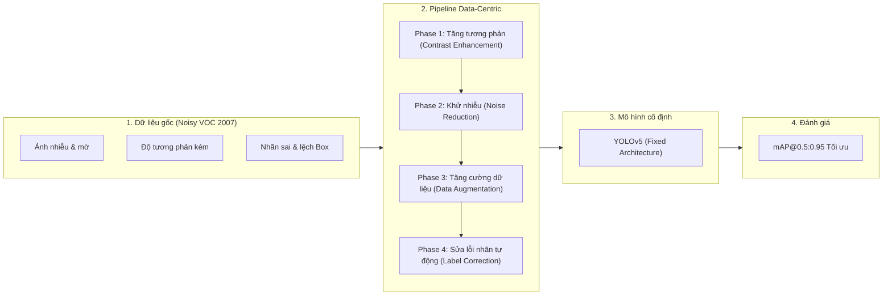

# 🎯 Data-Centric AI: Noisy PASCAL VOC Challenge (Kaggle Competition)

[](https://www.kaggle.com/competitions/data-centric-noisy-pascal-challenge)
[](https://www.python.org/)
[](https://pytorch.org/)
[](https://github.com/ultralytics/yolov5)
[](https://opencv.org/)
[](https://albumentations.ai/)

Dự án nghiên cứu và phát triển giải pháp phát hiện vật thể (Object Detection) theo triết lý **Data-Centric AI**, tham gia cuộc thi **[Data-Centric AI: Noisy PASCAL VOC Challenge](https://www.kaggle.com/competitions/data-centric-noisy-pascal-challenge)** trên nền tảng Kaggle.

Khác với mô hình tiếp cận truyền thống (Model-Centric AI - tập trung tinh chỉnh kiến trúc mô hình, thay đổi backbone, hyperparameter tuning phức tạp), cuộc thi đặt ra bài toán tối ưu **chất lượng dữ liệu** trên tập dữ liệu **PASCAL VOC 2007** bị làm nhiễu (Noisy PASCAL VOC), trong khi kiến trúc mô hình (**YOLOv5**) được giữ cố định.

---

## 📌 Mục lục

- [Triết lý Data-Centric AI](#-triết-lý-data-centric-ai)
- [Cấu trúc 4 giai đoạn tối ưu (Four Phases)](#-cấu-trúc-4-giai-đoạn-tối-ưu-four-phases)
- [Cấu trúc thư mục](#-cấu-trúc-thư-mục)
- [Đặc điểm tập dữ liệu (Dataset)](#-đặc-điểm-tập-dữ-liệu-dataset)
- [Thước đo đánh giá (Evaluation Metric)](#-thước-đo-đánh-giá-evaluation-metric)
- [Quy cách nộp bài (Submission Format)](#-quy-cách-nộp-bài-submission-format)
- [Quy định cuộc thi & Tính tái lập (Rules & Reproducibility)](#-quy-định-cuộc-thi--tính-tái-lập-rules--reproducibility)
- [Hướng dẫn cài đặt & Thực thi](#-hướng-dẫn-cài-đặt--thực-thi)

---

## 💡 Triết lý Data-Centric AI

Trong các bài toán thị giác máy tính thực tế, chất lượng của dữ liệu đầu vào đóng vai trò quyết định đến hiệu suất tổng thể của mô hình:

$$\text{Hiệu suất thực tế} = f(\text{Chất lượng dữ liệu}, \text{Kiến trúc mô hình})$$

Khi kiến trúc mô hình đã đạt đến trạng thái bão hòa hoặc bị cố định, việc lọc sạch nhiễu (noise), tăng cường độ tương phản, chuẩn hóa nhãn (label cleansing) và áp dụng các chiến lược tăng cường dữ liệu (data augmentation) thông minh là chìa khóa then chốt để đẩy cao độ chính xác mAP.



---

## 🔬 Cấu trúc 4 giai đoạn tối ưu (Four Phases)

Cuộc thi được phân chia thành 4 giai đoạn xử lý cốt lõi:

### 1. Phase 1: Contrast Enhancement (Tăng cường độ tương phản)
- **Mục tiêu**: Khắc phục hiện tượng ảnh chụp bị thiếu sáng, thừa sáng, dải tương phản động hẹp hoặc sương mù/mờ.
- **Kỹ thuật áp dụng**:
  - **CLAHE (Contrast Limited Adaptive Histogram Equalization)**: Cân bằng biểu đồ sáng cục bộ thích ứng, tránh khuếch đại nhiễu hạt.
  - **Gamma Correction**: Điều chỉnh độ phi tuyến tính $I_{\text{out}} = I_{\text{in}}^{\gamma}$ để làm rõ chi tiết vùng tối.
  - **Histogram Stretching / Equalization**: Kéo giãn biểu đồ phân bố mức xám.
  - **Unsharp Masking**: Tăng độ sắc nét các cạnh viền đối tượng.

### 2. Phase 2: Noise Reduction (Khử nhiễu ảnh)
- **Mục tiêu**: Loại bỏ các hạt nhiễu Gaussian, nhiễu muối tiêu (Salt-and-Pepper), nhiễu sọc tần số cao xuất hiện trong ảnh huấn luyện.
- **Kỹ thuật áp dụng**:
  - **Bilateral Filter**: Khử nhiễu bảo toàn biên cạnh đối tượng (edge-preserving).
  - **Non-Local Means Denoising (NLM)**: So khớp cấu trúc tự tương đồng giữa các patch ảnh.
  - **Gaussian / Median Filter**: Lọc trung vị / Gaussian đa chiều.
  - **Frequency Domain Filtering**: Biến đổi Fourier (FFT) / Wavelet Denoising nhằm triệt tiêu các thành phần phổ nhiễu tần số cao.

### 3. Phase 3: Data Augmentation (Tăng cường dữ liệu)
- **Mục tiêu**: Nâng cao tính đa dạng của dữ liệu và khả năng tổng quát hóa (generalization) của mô hình YOLOv5.
- **Kỹ thuật áp dụng**:
  - **Mosaic Augmentation**: Ghép 4 bức ảnh với các tỷ lệ khác nhau, tăng cường khả năng học đối tượng đa kích thước.
  - **MixUp**: Trộn tuyến tính 2 ảnh và nhãn theo phân bố Beta.
  - **HSV Color Jitter**: Biến thiên Hue, Saturation, Value có kiểm soát.
  - **Geometric Transformations**: Random horizontal flip, affine scaling, rotation nhẹ, translation.

### 4. Phase 4: Label Error Detection & Correction (Phát hiện & Sửa lỗi nhãn)
- **Mục tiêu**: Phát hiện và chỉnh sửa có hệ thống các lỗi gán nhãn: nhãn phân lớp sai (misclassified labels), bounding box bị lệch tọa độ (shifted/noisy bboxes), box bị bỏ sót (missing annotations).
- **Yêu cầu quan trọng**: Thực hiện bằng **thuật toán tự động, có tính tái lập (programmatic & reproducible)**, nghiêm cấm chỉnh sửa thủ công bằng tay.
- **Kỹ thuật áp dụng**:
  - **Confident Learning / Cleanlab**: Ước lượng phân bố ma trận chuyển tiếp nhiễu nhãn (joint distribution of noisy and true labels).
  - **Out-of-Fold (OOF) Ensembling & Verification**: Huấn luyện $K$-Fold cross validation để tìm mẫu có loss bất thường cao (loss outliers).
  - **Bounding Box Refinement Heuristics**: Kiểm tra tỷ lệ kích thước box (aspect ratio filtering), lọc box trùng lặp dị thường.

---

## 📁 Cấu trúc thư mục

```text
Data-Centric AI Noisy PASCAL VOC Challenge/
├── Data/
│   ├── voc2007.yaml               # Cấu hình dataset cho YOLOv5 (đường dẫn & danh sách 20 classes)
│   └── voc2007/
│       ├── images/
│       │   ├── train/             # Ảnh huấn luyện (.jpg) chứa nhiễu
│       │   └── test/              # Ảnh kiểm thử (.jpg) phục vụ dự đoán
│       └── labels/
│           └── train/             # Tệp nhãn YOLOv5 format (.txt) tương ứng
├── Notebooks/
│   └── solve.ipynb                # Pipeline hoàn chỉnh: Preprocessing -> Cleansing -> Train YOLOv5 -> Inference
└── README.md                      # Tài liệu tổng quan dự án
```

---

## 📊 Đặc điểm tập dữ liệu (Dataset)

Bộ dữ liệu cuộc thi là phiên bản **Noisy PASCAL VOC 2007** gồm 20 lớp đối tượng tiêu chuẩn:

| Danh mục | Danh sách các lớp (20 VOC Classes) |
| :--- | :--- |
| **Person** | `person` |
| **Animal** | `bird`, `cat`, `cow`, `dog`, `horse`, `sheep` |
| **Vehicle** | `aeroplane`, `bicycle`, `boat`, `bus`, `car`, `motorbike`, `train` |
| **Indoor** | `bottle`, `chair`, `diningtable`, `pottedplant`, `sofa`, `tvmonitor` |

### Định dạng nhãn YOLOv5 (`.txt`)
Mỗi tệp nhãn tương ứng với một tệp ảnh, bao gồm các dòng biểu diễn bounding box theo dạng chuẩn hóa $[0, 1]$:
```text
<class_id> <x_center> <y_center> <width> <height>
```
- `class_id`: Chỉ số phân lớp đối tượng (từ $0$ đến $19$).
- `x_center`, `y_center`: Tọa độ tâm của bounding box (đã chia cho chiều rộng/chiều cao ảnh).
- `width`, `height`: Kích thước chiều rộng và chiều cao của bounding box (đã chuẩn hóa).

*Ví dụ:*
```text
6 0.485000 0.533000 0.122000 0.250000
14 0.719000 0.442000 0.098000 0.143000
```

---

## 📐 Thước đo đánh giá (Evaluation Metric)

Hiệu suất mô hình được đánh giá thông qua chỉ số **mAP@[0.5:0.95] (Mean Average Precision)**:

1. **Intersection over Union (IoU)**:
   $$\text{IoU} = \frac{\text{Area of Overlap}}{\text{Area of Union}} = \frac{|\mathcal{B}_{\text{pred}} \cap \mathcal{B}_{\text{gt}}|}{|\mathcal{B}_{\text{pred}} \cup \mathcal{B}_{\text{gt}}|}$$

2. **Average Precision (AP)**:
   Diện tích dưới đường cong Precision-Recall (PR curve) tại một ngưỡng IoU $\alpha$:
   $$\text{AP}_{\alpha} = \int_{0}^{1} p(r) \, dr$$

3. **mAP@[0.5:0.95]**:
   Trung bình cộng của mAP trên 10 ngưỡng IoU từ $0.50$ đến $0.95$ với bước nhảy $0.05$ (tính trên toàn bộ $C = 20$ classes):
   $$\text{mAP@[0.5:0.95]} = \frac{1}{|T|} \sum_{\alpha \in T} \left( \frac{1}{C} \sum_{c=1}^{C} \text{AP}_{\alpha, c} \right)$$
   với $T = \{0.50, 0.55, 0.60, 0.65, 0.70, 0.75, 0.80, 0.85, 0.90, 0.95\}$.

---

## 📝 Quy cách nộp bài (Submission Format)

Tệp nộp bài có định dạng `.csv` gồm các cột:
- `image_id`: Tên tệp ảnh kiểm thử (ví dụ: `000001.jpg`).
- `prediction_string`: Chuỗi gom các box dự đoán theo cấu trúc: `{label confidence x_center y_center width height}` phân cách bởi dấu khoảng trắng.
- `image_width`: Chiều rộng ảnh gốc (pixel).
- `image_height`: Chiều cao ảnh gốc (pixel).
- `Usage`: Cố định giá trị `Public` (phục vụ yêu cầu nền tảng chấm điểm Kaggle).

### Cấu trúc file mẫu:
```csv
image_id,prediction_string,image_width,image_height,Usage
002084.jpg,7 0.9342 0.3527 0.5056 0.6568 0.9747 7 0.7538 0.4666 0.5264 0.9202 0.9442,500,375,Public
007875.jpg,7 0.9515 0.4752 0.5047 0.9505 0.9732,414,500,Public
```

---

## ⚖️ Quy định cuộc thi & Tính tái lập (Rules & Reproducibility)

- **Nguyên tắc Data-Centric**: Tuyệt đối **không thay đổi** kiến trúc mạng mô hình YOLOv5, số lượng epochs hoặc can thiệp hyperparameter ngoài phạm vi cho phép của từng Phase.
- **Tiền xử lý (Phase 1 & 2)**: Xây dựng hàm tiền xử lý (preprocessing function) áp dụng đồng nhất cho cả tập train, validation và test trước khi đưa vào mô hình.
- **Khử lỗi nhãn (Phase 4)**: Toàn bộ quá trình phát hiện và hiệu chỉnh nhãn phải được thực thi bằng mã nguồn/thuật toán lập trình (programmatic approach). Nghiêm cấm chỉnh sửa nhãn thủ công (no manual hand-labeling).
- **Quy mô đội thi**: Tối đa 2 thành viên / đội.
- **Giới hạn nộp bài**: Tối đa 20 lượt submit / ngày.

---

## 🚀 Hướng dẫn cài đặt & Thực thi

### 1. Cài đặt môi trường
Khuyến nghị sử dụng môi trường Python 3.8+ với GPU hỗ trợ CUDA:

```bash
# Clone hoặc điều hướng vào thư mục dự án
cd "d:/AI/Exercise/More Project/Data-Centric AI Noisy PASCAL VOC Challenge"

# Cài đặt các thư viện phụ thuộc
pip install torch torchvision --index-url https://download.pytorch.org/whl/cu121
pip install opencv-python albumentations matplotlib pandas scikit-learn pyyaml cleanlab
```

### 2. Tải dữ liệu từ Kaggle
```bash
kaggle competitions download -c data-centric-noisy-pascal-challenge -p ./Data
# Giải nén tập tin vào thư mục Data/
```

### 3. Thực thi Pipeline trong Notebook
Mở và thực thi theo tuần tự trong [Notebooks/solve.ipynb](file:///d:/AI/Exercise/More%20Project/Data-Centric%20AI%20Noisy%20PASCAL%20VOC%20Challenge/Notebooks/solve.ipynb):
1. **Khám phá & Thống kê dữ liệu (EDA)**: Phân tích phân bố nhiễu và chất lượng nhãn.
2. **Xây dựng Preprocessing Pipeline**: Tích hợp CLAHE + Bilateral/Wavelet Filtering.
3. **Lọc sạch nhãn lỗi (Cleanlab / OOF Residuals)**: Tự động hiệu chỉnh bounding box và class IDs.
4. **Huấn luyện YOLOv5**: Train mô hình với data đã được làm sạch và augment.
5. **Inference & Xuất kết quả**: Tạo file `submission.csv` đạt chuẩn đánh giá.

