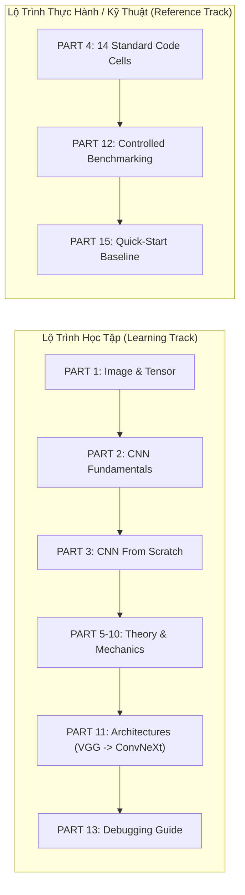
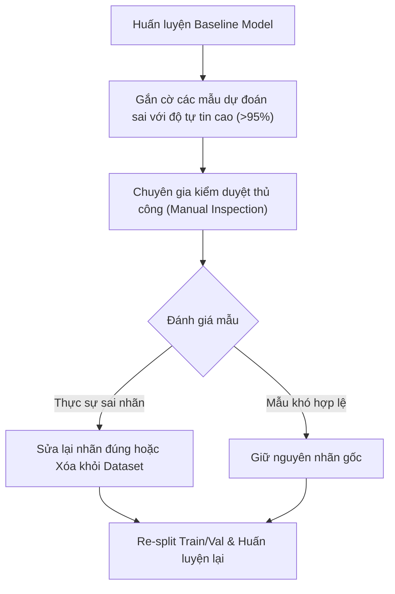
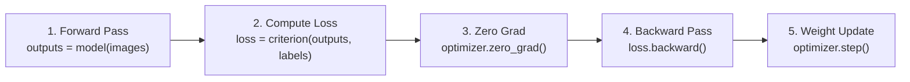
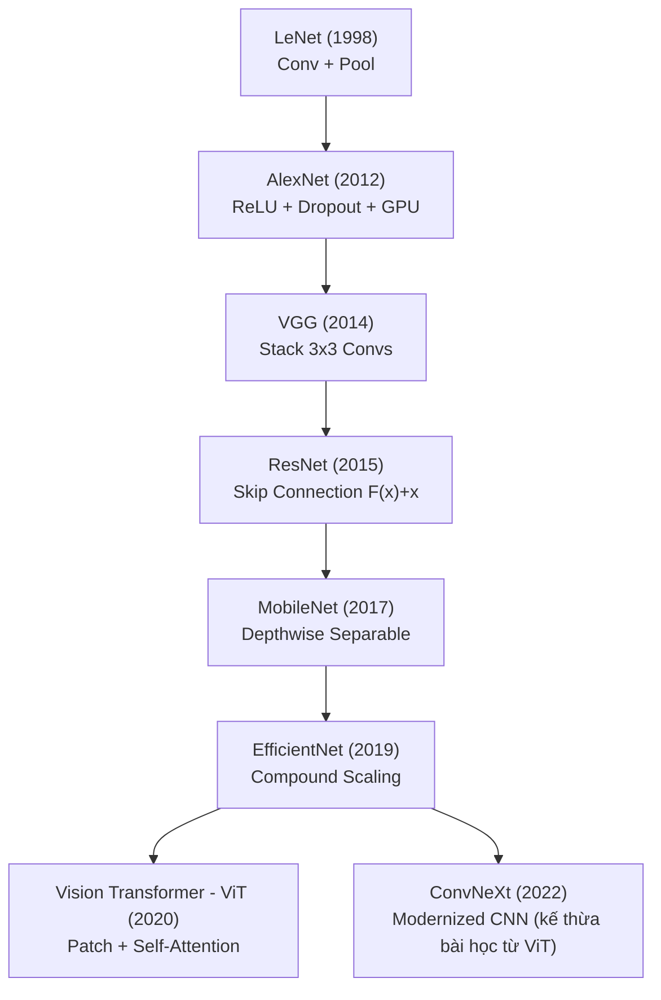

# 📘 CẨM NANG TOÀN DIỆN VỀ MẠNG NƠ-RON TÍCH CHẬP (CNN) & PIPELINE THỊ GIÁC MÁY TÍNH
> **Trọng tâm tài liệu:** Hướng dẫn học chuyên sâu về **Phân loại hình ảnh (Image Classification)** bằng CNN trong PyTorch, từ bản chất toán học/tensor, cách tự tay xây dựng từng tầng mạng từ con số 0 (From Scratch), phân tích các kiến trúc kinh điển (VGG, ResNet, MobileNet, EfficientNet, ConvNeXt), đến bộ khung 14 Code Cells huấn luyện chuẩn mực và quy trình gỡ lỗi (Debugging / Data Audit).

---

## 📑 MỤC LỤC TỔNG QUAN

- [PART 0 — Hướng Dẫn Sử Dụng Tài Liệu (How to Use This Guide)](#part-0--hướng-dẫn-sử-dụng-tài-liệu-how-to-use-this-guide)
- [PART 1 — Nền Tảng Hình Ảnh & Tensor (Image & Tensor Fundamentals)](#part-1--nền-tảng-hình-ảnh--tensor-image--tensor-fundamentals)
- [PART 2 — Bản Chất & Các Thành Phần Cốt Lõi Của CNN (CNN Fundamentals)](#part-2--bản-chất--các-thành-phần-cốt-lõi-của-cnn-cnn-fundamentals)
  - [2.1 Tích chập (Convolution & Feature Maps)](#21-tích-chập-convolution--feature-maps)
  - [2.2 Công thức tính Tensor Shape đầu ra](#22-công-thức-tính-tensor-shape-đầu-ra)
  - [2.3 Đệm viền (Padding)](#23-đệm-viền-padding)
  - [2.4 Bước nhảy (Stride)](#24-bước-nhảy-stride)
  - [2.5 Gom cụm không gian (Pooling) vs Stride Convolution](#25-gom-cụm-không-gian-pooling-vs-stride-convolution)
  - [2.6 Hàm kích hoạt phi tuyến (Activation Functions)](#26-hàm-kích-hoạt-phi-tuyến-activation-functions)
  - [2.7 Bản chất của Kênh (Channels as Feature Detectors)](#27-bản-chất-của-kênh-channels-as-feature-detectors)
  - [2.8 Vùng tiếp nhận (Receptive Field)](#28-vùng-tiếp-nhận-receptive-field)
  - [2.9 Flatten vs Global Average Pooling (GAP)](#29-flatten-vs-global-average-pooling-gap)
  - [2.10 Tầng phân loại tuyến tính (Linear / Classifier Head)](#210-tầng-phân-loại-tuyến-tính-linear--classifier-head)
  - [2.11 Logits, Softmax & Xác suất](#211-logits-softmax--xác-suất)
  - [2.12 Bản chất của nn.CrossEntropyLoss trong PyTorch](#212-bản-chất-của-nncrossentropyloss-trong-pytorch)
- [PART 3 — Tự Xây Dựng CNN Từ Con Số 0 (Build CNN From Scratch)](#part-3--tự-xây-dựng-cnn-từ-con-số-0-build-cnn-from-scratch)
  - [Model 0: Minimal CNN (Mô hình tối giản)](#model-0--minimal-cnn-mô-hình-tối-giản)
  - [Model 1: Deeper CNN (Tăng chiều sâu mạng)](#model-1--deeper-cnn-tăng-chiều-sâu-mạng)
  - [Model 2: Thêm Batch Normalization (Ổn định huấn luyện)](#model-2--thêm-batch-normalization-ổn-định-huấn-luyện)
  - [Model 3: Thêm Dropout (Chống Overfitting)](#model-3--thêm-dropout-chống-overfitting)
  - [Model 4: Custom Modular CNN hoàn chỉnh với Shape Tracking](#model-4--custom-modular-cnn-hoàn-chỉnh-với-shape-tracking)
- [PART 4 — Bộ 14 Cell Huấn Luyện Chuẩn Mực (Standard Training Pipeline)](#part-4--bộ-14-cell-huấn-luyện-chuẩn-mực-standard-training-pipeline)
  - [Cell 1: Imports & Thư viện](#cell-1--import-libraries--dependencies)
  - [Cell 2: Khóa Seed & Cấu hình Tính Tái lập](#cell-2--reproducibility--seed-setting)
  - [Cell 3: Cấu hình Phần cứng (Device & Hardware Acceleration)](#cell-3--device--hardware-acceleration)
  - [Cell 4: Config Master (Quản lý Tham số Tập Trung)](#cell-4--centralized-configuration-config-dataclass)
  - [Cell 5: Khám phá Dữ liệu & Phân bố Lớp (Dataset Inventory & Distribution)](#cell-5--dataset-inventory--class-distribution)
  - [Cell 6: Biến đổi & Tăng cường Dữ liệu (Transforms & Augmentation)](#cell-6--data-augmentation--transforms)
  - [Cell 7: Custom Dataset, DataLoaders & Train-Only Class Weights](#cell-7--custom-dataset-dataloaders--train-only-class-weights)
  - [Cell 8: Kiểm tra Trực quan Hợp lệ (Data Sanity Check)](#cell-8--data-sanity-check--visualizer)
  - [Cell 9: Factory Xây dựng Mô hình (Model Factory & Transfer Learning)](#cell-9--model-architecture-custom-cnn--transfer-learning)
  - [Cell 10: Loss Function, Optimizer & Learning Rate Scheduler Factories](#cell-10--loss-function-optimizer--lr-scheduler)
  - [Cell 11: Engine Huấn luyện & Đánh giá (Training & Validation Loop)](#cell-11--training-engine--validation-engine)
  - [Cell 12: Thực thi Huấn luyện & Vẽ Learning Curve](#cell-12--train-execution--learning-curves)
  - [Cell 13: Đánh giá Toàn diện & Phân tích Lỗi (Diagnostic & Audit)](#cell-13--comprehensive-evaluation--error-analysis)
  - [Cell 14: Suy luận (Inference) & Xuất mô hình (ONNX / TorchScript)](#cell-14--inference-engine--model-export)
- [PART 5 — Kiểm Toán & Thấu Hiểu Dữ Liệu (Advanced Data Audit & Cleaning)](#part-5--kiểm-toán--thấu-hiểu-dữ-liệu-advanced-data-audit--cleaning)
  - [5.1 Checklist Kiểm toán Dữ liệu Toàn diện](#51-checklist-kiểm-toán-dữ-liệu-toàn-diện)
  - [5.2 Các hàm thực thi kiểm toán dữ liệu thực tế](#52-các-hàm-thực-thi-kiểm-toán-dữ-liệu-thực-tế)
  - [5.3 Xử lý Dữ liệu Gán Sai Nhãn & Mơ Hồ (Mislabeled & Ambiguous Data)](#53-xử-lý-dữ-liệu-gán-sai-nhãn--mơ-hồ-mislabeled--ambiguous-data)
- [PART 6 — Phân Chia Tập Dữ Liệu & Rò Rỉ Dữ Liệu (Data Leakage)](#part-6--phân-chia-tập-dữ-liệu--rò-rỉ-dữ-liệu-data-leakage)
- [PART 7 — Cơ Chế Huấn Luyện & Dòng Chảy Gradient (Training Mechanics)](#part-7--cơ-chế-huấn-luyện--dòng-chảy-gradient-training-mechanics)
- [PART 8 — Thuật Toán Tối Ưu & Tốc Độ Học (Optimizer & LR Scheduler)](#part-8--thuật-toán-tối-ưu--tốc-độ-học-optimizer--lr-scheduler)
- [PART 9 — Kỹ Thuật Kiểm Soát Mô Hình (Regularization Strategies)](#part-9--kỹ-thuật-kiểm-soát-mô-hình-regularization-strategies)
- [PART 10 — Đánh Giá Chỉ Số & Phân Tích Lỗi Sai (Evaluation & Error Analysis)](#part-10--đánh-giá-chỉ-số--phân-tích-lỗi-sai-evaluation--error-analysis)
- [PART 11 — Tiến Hóa Của Các Kiến Trúc CNN (Architecture Evolution)](#part-11--tiến-hóa-của-các-kiến-trúc-cnn-architecture-evolution)
- [PART 12 — Thiết Kế Thử Nghiệm Đối Chứng (Controlled Experiments)](#part-12--thiết-kế-thử-nghiệm-đối-chứng-controlled-experiments)
- [PART 13 — Cẩm Nang Gỡ Lỗi Huấn Luyện (Debugging & Troubleshooting)](#part-13--cẩm-nang-gỡ-lỗi-huấn-luyện-debugging--troubleshooting)
- [PART 14 — Bài Tập Tự Luyện & Lời Giải (Mini Exercises & Solutions)](#part-14--bài-tập-tự-luyện--lời-giải-mini-exercises--solutions)
- [PART 15 — Mẫu Code Tối Giản Dùng Nhanh (Quick-Start Baseline)](#part-15--mẫu-code-tối-giản-dùng-nhanh-quick-start-baseline)

---

# PART 0 — Hướng Dẫn Sử Dụng Tài Liệu (How to Use This Guide)

Tài liệu này được thiết kế phục vụ song song **2 mục tiêu**:



> [!IMPORTANT]
> **Dành cho người mới bắt đầu:** Tuyệt đối không copy-paste toàn bộ 14 cell trong Part 4 khi chưa hiểu bản chất. Hãy đi tuần tự từ **Part 1 $\to$ Part 2 $\to$ Part 3** để nắm vững tư duy biến đổi chiều dữ liệu (Tensor Shapes) trước khi bắt tay vào train mô hình lớn.

### Phạm vi bài toán trong thị giác máy tính
Hướng dẫn này lấy trọng tâm cốt lõi là bài toán **Phân loại hình ảnh (Image Classification)**. Nền tảng CNN và tư duy kỹ thuật trong tài liệu này là bước đệm trực tiếp để bạn học các bài toán thị giác máy tính nâng cao hơn:

| Bài toán (Task) | Bản chất đầu ra (Output Format) | Kiến trúc mở rộng từ CNN cơ bản |
| :--- | :--- | :--- |
| **Image Classification** *(Trọng tâm guide này)* | Nhãn lớp (Class Label) | Backbone CNN + Classifier Head |
| **Object Detection** | Bounding Box $[x, y, w, h]$ + Class | Backbone CNN + FPN + Anchor/RoI Heads (YOLO, Faster R-CNN) |
| **Semantic Segmentation** | Mặt nạ phân đoạn từng pixel (Mask $[H, W]$) | Backbone CNN (Encoder) + Decoder Upsampling (U-Net, DeepLab) |

---

# PART 1 — Nền Tảng Hình Ảnh & Tensor (Image & Tensor Fundamentals)

### 1.1 Điểm ảnh (Pixel) và Kênh màu (Channel)
- Một bức ảnh số thực chất là một lưới ma trận 2D hoặc 3D chứa các con số:
  - **Ảnh mức xám (Grayscale):** Mỗi pixel là 1 giá trị vô hướng từ $0$ (đen) đến $255$ (trắng) biểu thị cường độ sáng $\to$ Ma trận 2D kích thước $[H, W]$.
  - **Ảnh màu (RGB):** Được ghép từ 3 ma trận độc lập tương ứng với 3 kênh: **R**ed (Đỏ), **G**reen (Xanh lục), **B**lue (Xanh dương) $\to$ Ma trận 3D kích thước $[3, H, W]$.

```text
Grayscale Image (1 Channel):             RGB Image (3 Channels):
     W = 4                                     W = 4
   ┌─────────┐                              ┌─────────┐
   │ 12  54  │                              │ R R R R │
H=4│ 89 210  │                         H=4  │ G G G G │  (3 ma trận xếp chồng lên nhau)
   │ 43  11  │                              │ B B B B │
   └─────────┘                              └─────────┘
  Shape: [1, 4, 4]                         Shape: [3, 4, 4]
```

### 1.2 Định dạng Tensor trong PyTorch: `NCHW`
Trong PyTorch, dữ liệu hình ảnh được chuẩn hóa theo quy ước thứ tự chiều:
- **Ảnh đơn lẻ:** `[C, H, W]` $\to$ $[Channels, Height, Width]$.
- **Lô huấn luyện (Batch of Images):** `[N, C, H, W]` hoặc `[B, C, H, W]` $\to$ $[Batch\_Size, Channels, Height, Width]$.

> [!NOTE]
> **Tại sao PyTorch dùng `NCHW` thay vì `NHWC` (như TensorFlow mặc định)?**  
> `NCHW` lưu trữ các pixel của cùng một kênh màu liên tục trong bộ nhớ RAM/VRAM. Định dạng này tương thích tối ưu nhất với các toán tử ma trận tích chập (cuDNN CUDA kernels), cho phép card đồ họa truy xuất bộ nhớ tuần tự (contiguous memory coalescing) với tốc độ cao nhất.

### 1.3 Ví dụ minh họa thực tế & Mini-Exercise
- **1 ảnh RGB kích thước $224 \times 224$:** Tensor shape = `[3, 224, 224]`.
- **1 batch gồm 64 ảnh RGB $224 \times 224$:** Tensor shape = `[64, 3, 224, 224]`.
- **1 batch gồm 32 ảnh Grayscale $28 \times 28$ (MNIST):** Tensor shape = `[32, 1, 28, 28]`.

**Self-check 1.1:** Nếu một video gồm $16$ khung hình RGB kích thước $112 \times 112$, batch size là $8$, tensor 5D của video trong PyTorch sẽ có shape thế nào?  
*(Đáp án: `[8, 3, 16, 112, 112]` theo quy ước `[B, C, T, H, W]`)*.

---

# PART 2 — Bản Chất & Các Thành Phần Cốt Lõi Của CNN (CNN Fundamentals)

Mỗi khái niệm dưới đây được giải thích chi tiết theo cấu trúc: **What $\to$ Why $\to$ How $\to$ Shape Formula $\to$ PyTorch Code $\to$ Common Mistakes $\to$ Self-Check**.

---

## 2.1 Tích chập (Convolution & Feature Maps)

- **What?** Phép tích chập 2D là thao tác trượt một ma trận trọng số nhỏ gọi là **Kernel (Filter)** qua từng vùng không gian của ảnh đầu vào để tính tích vô hướng (Dot Product), tạo ra bản đồ đặc trưng (**Feature Map**).
- **Why?** Khác với Mạng nơ-ron truyền thống (MLP) phải "duỗi phẳng" ảnh làm mất liên kết không gian (spatial relationship) và bùng nổ hàng triệu tham số, phép tích chập sở hữu 2 tính chất vượt trội:
  1. **Chia sẻ trọng số (Weight Sharing):** Cùng một kernel quét khắp bức ảnh.
  2. **Tính đồng biến với tịnh tiến (Translation Equivariance):** Phép tích chập có tính chất *Equivariance* (khi ảnh đầu vào dịch chuyển, đặc trưng trên Feature Map cũng dịch chuyển theo một khoảng tương ứng). Tính bất biến (*Translation Invariance*) thực sự được xây dựng khi kết hợp thêm Pooling, Global Aggregation, Data Augmentation và các tầng trừu tượng sâu.
- **How?** Kernel kích thước $K \times K$ trượt qua cửa sổ ảnh, nhân từng phần tử tương ứng rồi cộng lại kèm theo một hệ số chặn (Bias):

```text
Input Matrix (3x3):       Kernel (2x2):        Feature Map (2x2):
  [ 1  2  0 ]               [ 1  0 ]             [ (1*1+2*0+0*0+1*1)  (2*1+0*0+1*0+3*1) ]     [ 2  5 ]
  [ 0  1  3 ]      *        [ 0  1 ]      =      [ (0*1+1*0+2*0+1*1)  (1*1+3*0+1*0+0*1) ]  =  [ 1  1 ]
  [ 2  1  0 ]
```

- **Filter học được gì?**
  - Các tầng nông (đầu mạng): Học các đặc trưng cơ bản như **Cạnh (Edges), Góc (Corners), Đường vân (Textures)**.
  - Các tầng trung gian: Học các mẫu hoa văn phức tạp hơn như **Hình tròn, Mắt, Mũi, Lưới**.
  - Các tầng sâu (cuối mạng): Học các **Bộ phận hoàn chỉnh (Khuôn mặt, Bánh xe, Cánh chim)**.

```python
# PyTorch Code
import torch
import torch.nn as nn

conv = nn.Conv2d(in_channels=3, out_channels=16, kernel_size=3, stride=1, padding=1)
x = torch.randn(8, 3, 32, 32)
out = conv(x)
print(f"Output Shape: {out.shape}")  # torch.Size([8, 16, 32, 32])
```

---

## 2.2 Công thức tính Tensor Shape đầu ra

Công thức chuẩn xác để tính chiều dài ($H_{out}$) và chiều rộng ($W_{out}$) sau khi đi qua một tầng Conv2d hoặc MaxPool2d:

$$\Large H_{out} = \left\lfloor \frac{H_{in} + 2P - D(K - 1) - 1}{S} + 1 \right\rfloor$$

Trong đó:
- $H_{in}, W_{in}$: Kích thước không gian đầu vào.
- $K$: Kích thước Kernel (`kernel_size`).
- $S$: Bước nhảy (`stride`).
- $P$: Độ dày đệm viền (`padding`).
- $D$: Hệ số giãn cách (`dilation`, mặc định bằng $1$).
- $\lfloor \cdot \rfloor$: Phép lấy phần nguyên sàn (`floor`).

Khi $D=1$, công thức rút gọn thành:

$$H_{out} = \left\lfloor \frac{H_{in} + 2P - K}{S} \right\rfloor + 1$$

### Hai bài toán tính mẫu kinh điển:
1. **Giữ nguyên kích thước (Same Spatial Size):**
   - $H_{in}=32$, $K=3$, $S=1$, $P=1$.
   - $H_{out} = \lfloor \frac{32 + 2(1) - 3}{1} \rfloor + 1 = 32$.
2. **Thu nhỏ 1 nửa kích thước (Downsampling by Stride 2):**
   - $H_{in}=32$, $K=3$, $S=2$, $P=1$.
   - $H_{out} = \lfloor \frac{32 + 2(1) - 3}{2} \rfloor + 1 = \lfloor \frac{31}{2} \rfloor + 1 = 15 + 1 = 16$.

---

## 2.3 Đệm viền (Padding)

- **What?** Kỹ thuật thêm các giá trị $0$ (Zero-padding) hoặc giá trị phản chiếu xung quanh đường biên của bức ảnh.
- **Why?** 
  1. **Chống mất mát thông tin viền (Border Information Loss):** Nếu không padding ($P=0$), các pixel ở viền chỉ được kernel quét qua 1 lần, trong khi pixel ở giữa được quét nhiều lần.
  2. **Kiểm soát kích thước không gian:** Giúp ta giữ nguyên $H \times W$ qua nhiều tầng Conv liên tiếp mà không bị ảnh hưởng co rút quá nhanh.

```text
No Padding (P=0): Kích thước giảm 32x32 -> 30x30 (với K=3)
With Padding (P=1): Kích thước giữ nguyên 32x32 -> 32x32 (với K=3, S=1)
```

---

## 2.4 Bước nhảy (Stride)

- **What?** Khoảng cách (số pixel) mà kernel dịch chuyển sau mỗi lần tính tích chập.
- **How?** 
  - `stride=1`: Kernel dịch chuyển từng pixel một $\to$ Chi tiết cao, giữ nguyên hoặc giảm chậm kích thước.
  - `stride=2`: Kernel nhảy cách $2$ pixel $\to$ Kích thước không gian giảm đi xấp xỉ một nửa ($/2$), giảm khối lượng tính toán FLOPs.

---

## 2.5 Gom cụm không gian (Pooling) vs Stride Convolution

- **What?** Pooling là phép toán trượt cửa sổ không có trọng số học được để lấy giá trị lớn nhất (**MaxPool2d**) hoặc trung bình (**AvgPool2d**).
- **Tại sao giảm kích thước từ $224 \to 112 \to 56 \dots$?**
  1. Giảm số lượng tham số tính toán cho các tầng phía sau.
  2. Tăng **Receptive Field** (tầm nhìn) để tầng sâu quan sát được vùng ảnh lớn hơn.
  3. Tạo tính bất biến nhẹ với sự dịch chuyển/biến dạng của vật thể.
- **Mất mát thông tin (Information Loss):** MaxPool loại bỏ 75% số điểm ảnh (khi kernel 2x2, stride 2).
- **Xu hướng hiện đại:** Nhiều kiến trúc mới (ResNet, ConvNeXt) loại bỏ dần MaxPool và thay bằng **Convolution với `stride=2`** để mạng tự học cách downsampling tối ưu nhất thay vì gán cứng bằng quy tắc Max/Avg.

```python
# So sánh MaxPool và Stride Conv Downsampling
pool = nn.MaxPool2d(kernel_size=2, stride=2)            # 0 tham số
strided_conv = nn.Conv2d(64, 128, kernel_size=3, stride=2, padding=1) # Có tham số học được
```

---

## 2.6 Hàm kích hoạt phi tuyến (Activation Functions)

- **What?** Hàm toán học áp dụng lên từng phần tử sau phép tích chập hoặc nhân ma trận.
- **Why?** Nếu xếp chồng (stack) liên tiếp nhiều tầng Conv và Linear mà **không có hàm kích hoạt phi tuyến**, toàn bộ mạng sẽ chỉ tương đương với **1 phép biến đổi tuyến tính đơn lẻ**:
  $$y = W_3(W_2(W_1 x + b_1) + b_2) + b_3 = W_{total} x + b_{total}$$
  Khi đó mạng không thể học được các quan hệ phi tuyến phức tạp trong thế giới thực.
- **Các hàm kích hoạt phổ biến:**
  - **ReLU ($\max(0, x)$):** Đơn giản, tính toán cực nhanh, giảm thiểu triệt để hiện tượng biến mất gradient (Vanishing Gradient).
  - **LeakyReLU ($\max(\alpha x, x)$):** Tránh hiện tượng "Dying ReLU" (neuron chết khi $x < 0$).
  - **GELU / SiLU (Swish):** Các hàm trơn mượt được ứng dụng trong các kiến trúc hiện đại (EfficientNet, ConvNeXt, Vision Transformers).

---

## 2.7 Bản chất của Kênh (Channels as Feature Detectors)

Trong một mạng CNN chuẩn mực:

$$\text{Input: } 3 \xrightarrow{\text{Conv}} 32 \xrightarrow{\text{Conv}} 64 \xrightarrow{\text{Conv}} 128 \xrightarrow{\text{Conv}} 256$$

> [!IMPORTANT]
> **Quy tắc vàng của CNN:** Độ phân giải không gian giảm dần ($H, W \downarrow$), nhưng số lượng kênh tăng dần ($C \uparrow$).
> - **Channel ở tầng 1:** Là 3 kênh màu RGB.
> - **Channel ở tầng sâu:** Mỗi kênh là một **Bộ phát hiện khái niệm (Concept Detector)**. Ví dụ: Kênh 12 chuyên kích hoạt khi thấy họa tiết mắt tròn, Kênh 45 kích hoạt khi thấy bề mặt lông thú, Kênh 88 kích hoạt khi thấy góc nhọn kim loại.

---

## 2.8 Vùng tiếp nhận (Receptive Field)

- **What?** Receptive Field (RF) là vùng không gian trên bức ảnh đầu vào gốc mà một neuron tại tầng hiện tại có thể "nhìn thấy".
- **Intuition:**
  - Tầng Conv 1 (kernel 3x3): Mỗi điểm nhìn thấy vùng $3 \times 3$ pixel của ảnh gốc.
  - Tầng Conv 2 (kernel 3x3): Mỗi điểm nhìn thấy vùng $3 \times 3$ của Conv 1 $\to$ Tương đương nhìn thấy $5 \times 5$ pixel của ảnh gốc.
  - Càng đi sâu vào mạng (qua nhiều tầng Conv và Pooling), Receptive Field càng mở rộng, giúp mạng nắm bắt được **ngữ cảnh toàn cục (Global Context)**.

```text
Layer 2 Feature:                [   *   ]          (Nhìn thấy 5x5 ảnh gốc)
                                 /  |  \
Layer 1 Features:             [ *   *   * ]        (Nhìn thấy 3x3 ảnh gốc)
                             /  |  \
Input Image Pixels:        [ .  .  .  .  . ]
```

---

## 2.9 Flatten vs Global Average Pooling (GAP)

| Tiêu chí | `nn.Flatten()` | `nn.AdaptiveAvgPool2d((1, 1))` (GAP) |
| :--- | :--- | :--- |
| **Cơ chế** | Duỗi thẳng toàn bộ tensor $[B, C, H, W] \to [B, C \times H \times W]$. | Lấy giá trị trung bình trên từng kênh $[B, C, H, W] \to [B, C, 1, 1] \to [B, C]$. |
| **Số lượng tham số** | Rất lớn ở tầng Linear tiếp theo (Parameter Explosion). | **0 tham số**, giảm cực mạnh trọng số cho tầng Linear. |
| **Kích thước ảnh đầu vào** | Bắt buộc cố định cứng (ví dụ: chỉ nhận đúng $224 \times 224$). | **Linh hoạt**, nhận mọi kích thước ảnh đầu vào bất kỳ. |
| **Chống Overfitting** | Dễ bị Overfitting do quá nhiều trọng số. | Khả năng tổng quát hóa (Generalization) vượt trội. |

---

## 2.10 Tầng phân loại tuyến tính (Linear / Classifier Head)

Sau khi trích xuất các đặc trưng không gian bằng CNN Backbone và tóm tắt thành vector đặc trưng qua Global Average Pooling (kích thước $[B, C]$), tầng **Classifier Head** đóng vai trò quyết định lớp:

```python
self.classifier = nn.Sequential(
    nn.Linear(in_features=256, out_features=128),  # Kết hợp 256 đặc trưng thành 128 biểu diễn cô đọng
    nn.ReLU(inplace=True),
    nn.Dropout(0.5),
    nn.Linear(in_features=128, out_features=num_classes) # Đưa ra điểm số cho từng lớp (Logits)
)
```

> [!NOTE]
> **Tại sao số chiều output bắt buộc phải khớp chính xác với số class?**  
> Tầng Linear cuối cùng thực chất thực hiện $C$ phép tích vô hướng song song giữa vector đặc trưng $x \in \mathbb{R}^{D}$ và $C$ vector trọng số phân loại $w_i \in \mathbb{R}^{D}$ ($i = 0, \dots, C-1$). Mỗi đầu ra $z_i = w_i^T x + b_i$ đại diện cho mức độ tương đồng (điểm Logit) của mẫu ảnh với lớp thứ $i$. Do đó, nếu số chiều output lệch so với số class, hàm Loss sẽ không thể ánh xạ chính xác với nhãn Ground Truth dạng số nguyên $[0, C-1]$.

---

## 2.11 Logits, Softmax & Xác suất

- **Logits:** Là các giá trị số thực thô ($-\infty \to +\infty$) do tầng `Linear` cuối cùng sinh ra. Logits **chưa phải là xác suất**.
- **Softmax:** Ánh xạ vector Logits thành phân phối xác suất ($[0, 1]$ và tổng bằng $1$):

$$P(y = c \mid x) = \frac{e^{z_c}}{\sum_{j=1}^{C} e^{z_j}}$$

---

## 2.12 Bản chất của nn.CrossEntropyLoss trong PyTorch

> [!CAUTION]
> **LỖI KINH ĐIỂN CỦA NGƯỜI MỚI HỌC PYTORCH:**
> Trong PyTorch, class `nn.CrossEntropyLoss()` đã **TỰ ĐỘNG TÍCH HỢP** `nn.LogSoftmax()` và `nn.NLLLoss()` bên trong!
> 
> ❌ **SAI (Không bao giờ làm thế này):**
> ```python
> logits = model(images)
> probs = torch.softmax(logits, dim=1) # Đã áp dụng softmax ở ngoài
> loss = criterion(probs, labels)      # Gây lỗi toán học nghiêm trọng (bị double softmax)!
> ```
> 
> ✅ **ĐÚNG:**
> ```python
> logits = model(images)               # Đầu ra trực tiếp của mô hình không có Softmax
> loss = criterion(logits, labels)     # Truyền trực tiếp Logits vào CrossEntropyLoss
> ```

---

# PART 3 — Tự Xây Dựng CNN Từ Con Số 0 (Build CNN From Scratch)

Dưới đây là hành trình tiến hóa 5 bước từ mô hình CNN sơ khai đến kiến trúc tiêu chuẩn hoàn chỉnh.

---

### Model 0 — Minimal CNN (Mô hình tối giản)
Mô hình cơ bản nhất để kiểm tra luồng tensor: 1 Conv $\to$ ReLU $\to$ MaxPool $\to$ Flatten $\to$ Linear.

```python
import torch
import torch.nn as nn

class MinimalCNN(nn.Module):
    def __init__(self, num_classes: int = 10):
        super().__init__()
        # Input: [B, 3, 32, 32]
        self.conv = nn.Conv2d(in_channels=3, out_channels=16, kernel_size=3, padding=1) # -> [B, 16, 32, 32]
        self.relu = nn.ReLU()                                                            # -> [B, 16, 32, 32]
        self.pool = nn.MaxPool2d(kernel_size=2, stride=2)                               # -> [B, 16, 16, 16]
        self.fc = nn.Linear(16 * 16 * 16, num_classes)                                  # -> [B, num_classes]

    def forward(self, x):
        x = self.pool(self.relu(self.conv(x)))
        x = torch.flatten(x, start_dim=1)
        x = self.fc(x)
        return x
```

---

### Model 1 — Deeper CNN (Tăng chiều sâu mạng)
Tăng độ sâu để học đặc trưng đa cấp độ và sử dụng `AdaptiveAvgPool2d`.

```python
class DeeperCNN(nn.Module):
    def __init__(self, num_classes: int = 10):
        super().__init__()
        self.features = nn.Sequential(
            # Block 1: [B, 3, 32, 32] -> [B, 32, 16, 16]
            nn.Conv2d(3, 32, kernel_size=3, padding=1),
            nn.ReLU(),
            nn.MaxPool2d(2, 2),
            
            # Block 2: [B, 32, 16, 16] -> [B, 64, 8, 8]
            nn.Conv2d(32, 64, kernel_size=3, padding=1),
            nn.ReLU(),
            nn.MaxPool2d(2, 2)
        )
        self.gap = nn.AdaptiveAvgPool2d((1, 1)) # -> [B, 64, 1, 1]
        self.fc = nn.Linear(64, num_classes)    # -> [B, num_classes]

    def forward(self, x):
        x = self.features(x)
        x = self.gap(x)
        x = torch.flatten(x, 1)
        return self.fc(x)
```

---

### Model 2 — Thêm Batch Normalization (Ổn định huấn luyện)
- **BatchNorm làm gì?** Chuẩn hóa phân phối đầu ra của từng tầng về mean $\approx 0$, variance $\approx 1$.
- **Ý nghĩa thực tế:** Giúp bề mặt hàm mất mát (loss landscape) trơn mượt hơn, ổn định dòng chảy gradient qua các tầng sâu và thường cho phép sử dụng tốc độ học (Learning Rate) lớn hơn mà không bị phân kỳ.
- **Hành vi `train()` vs `eval()`:**
  - Trong `model.train()`: Tính mean/var trực tiếp trên batch hiện tại và cập nhật moving average tích lũy.
  - Trong `model.eval()`: Cố định và sử dụng running mean/var đã học để inference.

```python
# Minh họa khối Conv + BatchNorm + ReLU
nn.Sequential(
    nn.Conv2d(32, 64, kernel_size=3, padding=1, bias=False), # Khi có BN, bias của Conv là thừa thãi
    nn.BatchNorm2d(64),
    nn.ReLU(inplace=True)
)
```

---

### Model 3 — Thêm Dropout (Chống Overfitting)
- **Dropout làm gì?** Ngẫu nhiên ngắt kết nối (tắt về $0$) một tỉ lệ $p$ (ví dụ: $0.3 - 0.5$) neuron trong quá trình forward pass lúc huấn luyện.
- **Ý nghĩa:** Buộc mạng không được phụ thuộc vào bất kỳ một nhóm neuron cụ thể nào, học các biểu diễn phân tán (co-adaptation reduction).
- **Hành vi `train()` vs `eval()`:** Trong `eval()`, Dropout tự động bị vô hiệu hóa (tỉ lệ giữ lại là $100\%$).

---

### Model 4 — Custom Modular CNN hoàn chỉnh với Shape Tracking

Dưới đây là kiến trúc mạng hoàn chỉnh tiêu chuẩn cho mọi bài toán phân loại ảnh:

```python
class ConvBlock(nn.Module):
    """Khối tích chập tiêu chuẩn 2 tầng: (Conv-BN-ReLU) x 2 -> MaxPool."""
    def __init__(self, in_c: int, out_c: int, pool: bool = True):
        super().__init__()
        self.conv = nn.Sequential(
            nn.Conv2d(in_c, out_c, kernel_size=3, padding=1, bias=False),
            nn.BatchNorm2d(out_c),
            nn.ReLU(inplace=True),
            nn.Conv2d(out_c, out_c, kernel_size=3, padding=1, bias=False),
            nn.BatchNorm2d(out_c),
            nn.ReLU(inplace=True),
        )
        self.pool = nn.MaxPool2d(2, 2) if pool else nn.Identity()

    def forward(self, x):
        return self.pool(self.conv(x))

class CustomModularCNN(nn.Module):
    """Kiến trúc Modular CNN hoàn chỉnh hỗ trợ theo dõi Tensor Shape chi tiết."""
    def __init__(self, in_channels: int = 3, num_classes: int = 10):
        super().__init__()
        self.features = nn.Sequential(
            ConvBlock(in_channels, 32, pool=True),    # B1: [B, 3, 224, 224] -> [B, 32, 112, 112]
            ConvBlock(32, 64, pool=True),             # B2: [B, 32, 112, 112] -> [B, 64, 56, 56]
            ConvBlock(64, 128, pool=True),            # B3: [B, 64, 56, 56]  -> [B, 128, 28, 28]
            ConvBlock(128, 256, pool=True)            # B4: [B, 128, 28, 28] -> [B, 256, 14, 14]
        )
        self.global_pool = nn.AdaptiveAvgPool2d((1, 1)) # -> [B, 256, 1, 1]
        self.classifier = nn.Sequential(
            nn.Flatten(),                              # -> [B, 256]
            nn.Linear(256, 128),
            nn.BatchNorm1d(128),
            nn.ReLU(inplace=True),
            nn.Dropout(0.5),
            nn.Linear(128, num_classes)                # -> [B, num_classes] (Logits)
        )
        
    def forward(self, x):
        x = self.features(x)
        x = self.global_pool(x)
        x = self.classifier(x)
        return x
```

---

# PART 4 — Bộ 14 Cell Huấn Luyện Chuẩn Mực (Standard Training Pipeline)

Dưới đây là bộ khung **14 Code Cells độc lập, chuẩn mực kỹ thuật và chạy mượt mà**, được thiết kế theo mô hình Modular Factory Pattern để bạn tự tin áp dụng cho mọi dự án.

---

### Cell 1 — Import Libraries & Dependencies
```python
# ==========================================
# CELL 1: IMPORT STANDARD LIBRARIES
# ==========================================
import os
import sys
import gc
import json
import time
import math
import random
from pathlib import Path
from dataclasses import dataclass, asdict
from typing import Tuple, List, Dict, Optional, Any

# Xử lý ma trận & Dữ liệu
import numpy as np
import pandas as pd
from PIL import Image

# Trực quan hóa dữ liệu
import matplotlib.pyplot as plt
import seaborn as sns

# PyTorch Core & Vision
import torch
import torch.nn as nn
import torch.nn.functional as F
import torch.optim as optim
from torch.utils.data import Dataset, DataLoader, WeightedRandomSampler
import torchvision
from torchvision import transforms, models

# Tăng tốc tính toán & Đánh giá
from torch.amp import autocast, GradScaler
from tqdm.auto import tqdm
from sklearn.model_selection import train_test_split
from sklearn.metrics import (
    accuracy_score,
    balanced_accuracy_score,
    f1_score,
    precision_score,
    recall_score,
    classification_report,
    confusion_matrix
)

# Optional: Tải các backbone hiện đại (ResNet, ConvNeXt, EfficientNet)
try:
    import timm
except ImportError:
    pass

print(f"✓ PyTorch Version     : {torch.__version__}")
print(f"✓ Torchvision Version : {torchvision.__version__}")
```

---

### Cell 2 — Reproducibility & Seed Setting
```python
# ==========================================
# CELL 2: REPRODUCIBILITY & SEED
# ==========================================
def seed_everything(seed: int = 42, deterministic: bool = False):
    """
    Cố định seed cho Python, Numpy, PyTorch.
    Lưu ý: deterministic=True giúp tái lập tối đa nhưng có thể làm giảm tốc độ tính toán GPU.
    """
    random.seed(seed)
    os.environ['PYTHONHASHSEED'] = str(seed)
    np.random.seed(seed)
    torch.manual_seed(seed)
    if torch.cuda.is_available():
        torch.cuda.manual_seed(seed)
        torch.cuda.manual_seed_all(seed)
        if deterministic:
            torch.backends.cudnn.deterministic = True
            torch.backends.cudnn.benchmark = False
        else:
            torch.backends.cudnn.deterministic = False
            torch.backends.cudnn.benchmark = True

SEED = 42
seed_everything(SEED, deterministic=False)
print(f"✓ Seed locked to: {SEED} (Benchmark mode enabled for maximum training speed)")
```

---

### Cell 3 — Device & Hardware Acceleration
```python
# ==========================================
# CELL 3: DEVICE & HARDWARE ACCELERATION
# ==========================================
if torch.cuda.is_available():
    DEVICE = torch.device("cuda:0")
    gpu_name = torch.cuda.get_device_name(0)
    vram_gb = torch.cuda.get_device_properties(0).total_memory / (1024 ** 3)
    print(f"✓ Training on CUDA GPU: {gpu_name} ({vram_gb:.2f} GB VRAM)")
elif hasattr(torch.backends, "mps") and torch.backends.mps.is_available():
    DEVICE = torch.device("mps")
    print("✓ Training on Apple Silicon GPU (MPS)")
else:
    DEVICE = torch.device("cpu")
    print("⚠ CUDA not found. Training on CPU. Training will be slow!")
```

---

### Cell 4 — Centralized Configuration (Config Dataclass)
```python
# ==========================================
# CELL 4: CENTRALIZED CONFIGURATION
# ==========================================
@dataclass
class Config:
    # 1. Đường dẫn thư mục
    DATA_DIR: Path = Path("./Data")
    TRAIN_DIR: Path = DATA_DIR / "train"
    VAL_DIR: Optional[Path] = None  # Nếu None hoặc không tồn tại sẽ tự động Stratified Split từ TRAIN_DIR
    TEST_DIR: Path = DATA_DIR / "test"
    CHECKPOINT_DIR: Path = Path("./Checkpoints")
    LOGS_DIR: Path = Path("./logs")
    
    # 2. Đặc tả dữ liệu
    IMG_SIZE: Tuple[int, int] = (224, 224)  # (224, 224) hoặc (48, 48) tùy bài toán
    NUM_CHANNELS: int = 3                   # 1 cho Grayscale, 3 cho RGB
    NUM_CLASSES: int = 7                    # Số lượng class mục tiêu (sẽ được tự động validate)
    VAL_SPLIT_RATIO: float = 0.2            # Tỉ lệ chia validation nếu chưa có folder riêng
    
    # 3. Siêu tham số Huấn luyện
    BATCH_SIZE: int = 64
    NUM_WORKERS: int = 4                    # Windows để 0-2 nếu gặp lỗi multiprocessing
    PIN_MEMORY: bool = True
    
    # 4. Optimizer & LR Scheduler
    EPOCHS: int = 30
    LEARNING_RATE: float = 1e-3
    WEIGHT_DECAY: float = 1e-4
    OPTIMIZER_TYPE: str = "adamw"           # 'adamw', 'adam', 'sgd'
    SCHEDULER_TYPE: str = "cosine"          # 'cosine', 'plateau', 'step', 'onecycle'
    
    # 5. Regularization & Huấn luyện Tăng tốc
    USE_AMP: bool = True                    # Tự động bật Mixed Precision (fp16)
    EARLY_STOPPING_PATIENCE: int = 8        # Dừng sớm nếu val_loss không giảm sau n epochs
    LABEL_SMOOTHING: float = 0.05
    
    # 6. Lựa chọn Mô hình & Thử nghiệm
    MODEL_NAME: str = "custom_vgg"          # 'custom_vgg', 'resnet18', 'efficientnet_b0'
    PRETRAINED: bool = True                 # Dùng trọng số ImageNet cho pretrained model
    EXPERIMENT_NAME: str = "baseline_experiment_v1"

CFG = Config()
CFG.CHECKPOINT_DIR.mkdir(parents=True, exist_ok=True)
CFG.LOGS_DIR.mkdir(parents=True, exist_ok=True)
print(f"✓ Config master loaded for model: [{CFG.MODEL_NAME.upper()}]")
```

---

### Cell 5 — Dataset Inventory & Class Distribution
```python
# ==========================================
# CELL 5: DATASET INVENTORY & CANONICAL CLASS MAPPING
# ==========================================
def create_canonical_class_mapping(train_dir: Path) -> Tuple[Dict[str, int], Dict[int, str]]:
    """Tạo bộ ánh xạ nhãn chuẩn tắc (Canonical Mapping) duy nhất từ tập Train."""
    if not train_dir.exists():
        raise FileNotFoundError(f"Thư mục tập huấn luyện không tồn tại: {train_dir}")
    class_names = sorted([d.name for d in train_dir.iterdir() if d.is_dir()])
    if len(class_names) == 0:
        raise ValueError(f"Không tìm thấy thư mục class nào trong: {train_dir}")
    class_to_idx = {name: i for i, name in enumerate(class_names)}
    idx_to_class = {i: name for name, i in class_to_idx.items()}
    return class_to_idx, idx_to_class

def collect_dataset_paths(data_dir: Path, class_to_idx: Dict[str, int]) -> Tuple[List[str], List[int]]:
    """Quét dữ liệu ảnh dựa trên bộ ánh xạ class_to_idx chuẩn."""
    valid_exts = {".jpg", ".jpeg", ".png", ".bmp", ".webp"}
    dir_classes = sorted([d.name for d in data_dir.iterdir() if d.is_dir()])
    
    # Validate cấu trúc lớp đồng nhất (Fail Fast nếu lệch class)
    expected_classes = set(class_to_idx.keys())
    actual_classes = set(dir_classes)
    if expected_classes != actual_classes:
        diff = expected_classes ^ actual_classes
        raise ValueError(f"Lệch cấu trúc thư mục lớp tại {data_dir}! Danh sách khác biệt: {diff}")
        
    image_paths, labels = [], []
    for class_name in dir_classes:
        c_dir = data_dir / class_name
        for p in c_dir.glob("*.*"):
            if p.suffix.lower() in valid_exts:
                image_paths.append(str(p))
                labels.append(class_to_idx[class_name])
    return image_paths, labels

# 1. Khởi tạo Canonical Mapping từ TRAIN_DIR
CLASS_TO_IDX, IDX_TO_CLASS = create_canonical_class_mapping(CFG.TRAIN_DIR)
raw_train_paths, raw_train_labels = collect_dataset_paths(CFG.TRAIN_DIR, CLASS_TO_IDX)

# 2. Tự động xác thực NUM_CLASSES với dữ liệu thực tế
if CFG.NUM_CLASSES != len(CLASS_TO_IDX):
    print(f"⚠ Tự động cập nhật CFG.NUM_CLASSES: {CFG.NUM_CLASSES} -> {len(CLASS_TO_IDX)}")
    CFG.NUM_CLASSES = len(CLASS_TO_IDX)

# 3. Thống kê phân bố tập Train gốc
counts = pd.Series(raw_train_labels).value_counts().sort_index()
total_samples = len(raw_train_labels)

print("=" * 65)
print(f"TẬP TRAIN GỐC: {total_samples:,} ảnh | SỐ LỚP PHÂN LOẠI: {CFG.NUM_CLASSES}")
print("-" * 65)
for idx, count in counts.items():
    ratio = (count / total_samples) * 100
    print(f"  Class [{idx}] {IDX_TO_CLASS[idx]:<15}: {count:>6} ảnh ({ratio:>5.2f}%)")
print("=" * 65)
```

---

### Cell 6 — Data Augmentation & Transforms
```python
# ==========================================
# CELL 6: DATA TRANSFORMS PIPELINE
# ==========================================
# Chuẩn hóa ImageNet tiêu chuẩn cho RGB (3 kênh) hoặc Grayscale (1 kênh)
NORM_MEAN = [0.485, 0.456, 0.406] if CFG.NUM_CHANNELS == 3 else [0.5]
NORM_STD  = [0.229, 0.224, 0.225] if CFG.NUM_CHANNELS == 3 else [0.5]

train_transforms = transforms.Compose([
    transforms.Resize(CFG.IMG_SIZE),
    transforms.RandomResizedCrop(CFG.IMG_SIZE, scale=(0.85, 1.0)),
    transforms.RandomHorizontalFlip(p=0.5),
    transforms.RandomRotation(degrees=15),
    transforms.ColorJitter(brightness=0.2, contrast=0.2),
    transforms.ToTensor(),
    transforms.Normalize(mean=NORM_MEAN, std=NORM_STD)
])

val_test_transforms = transforms.Compose([
    transforms.Resize(CFG.IMG_SIZE),
    transforms.ToTensor(),
    transforms.Normalize(mean=NORM_MEAN, std=NORM_STD)
])

print("✓ Train & Val/Test Transforms configured successfully.")
```

---

### Cell 7 — Custom Dataset, DataLoaders & Train-Only Class Weights
```python
# ==========================================
# CELL 7: DATASET, DATALOADERS & TRAIN-ONLY CLASS WEIGHTS
# ==========================================
class GenericImageDataset(Dataset):
    """Dataset tổng quát đọc ảnh theo đường dẫn, chuyển đổi RGB/Grayscale nhất quán."""
    def __init__(self, image_paths: List[str], labels: List[int], transform=None, num_channels: int = 3):
        self.image_paths = image_paths
        self.labels = labels
        self.transform = transform
        self.num_channels = num_channels
        
    def __len__(self) -> int:
        return len(self.image_paths)
        
    def __getitem__(self, idx: int) -> Tuple[torch.Tensor, int]:
        img_path = self.image_paths[idx]
        image = Image.open(img_path)
        
        # Đảm bảo xử lý đúng số lượng kênh màu
        if self.num_channels == 3:
            image = image.convert("RGB")
        elif self.num_channels == 1:
            image = image.convert("L")
            
        if self.transform is not None:
            image = self.transform(image)
            
        label = self.labels[idx]
        return image, label

# 1. Xử lý tập Train và Validation (Ưu tiên VAL_DIR nếu có, nếu không thì Stratified Split)
if CFG.VAL_DIR is not None and CFG.VAL_DIR.exists() and any(CFG.VAL_DIR.iterdir()):
    print(f"✓ Nạp tập Validation từ thư mục riêng: {CFG.VAL_DIR}")
    val_paths, val_y = collect_dataset_paths(CFG.VAL_DIR, CLASS_TO_IDX)
    train_paths, train_y = raw_train_paths, raw_train_labels
else:
    print(f"✓ Tự động phân chia Stratified Split ({int((1-CFG.VAL_SPLIT_RATIO)*100)}% Train / {int(CFG.VAL_SPLIT_RATIO*100)}% Val)...")
    train_paths, val_paths, train_y, val_y = train_test_split(
        raw_train_paths,
        raw_train_labels,
        test_size=CFG.VAL_SPLIT_RATIO,
        random_state=SEED,
        stratify=raw_train_labels
    )

# 2. TÍNH CLASS WEIGHTS CHỈ TRÊN TẬP TRAIN (Tránh rò rỉ phân phối tập Validation)
train_counts = pd.Series(train_y).value_counts().sort_index()
total_train = len(train_y)
num_classes = len(CLASS_TO_IDX)
weights = [total_train / (num_classes * train_counts[i]) for i in range(num_classes)]
CLASS_WEIGHTS = torch.tensor(weights, dtype=torch.float32).to(DEVICE)
print(f"✓ Train-only Class Weights:\n{CLASS_WEIGHTS.cpu().numpy().round(4)}")

# 3. Khởi tạo Datasets & DataLoaders
train_dataset = GenericImageDataset(train_paths, train_y, transform=train_transforms, num_channels=CFG.NUM_CHANNELS)
val_dataset   = GenericImageDataset(val_paths, val_y, transform=val_test_transforms, num_channels=CFG.NUM_CHANNELS)

train_loader = DataLoader(
    train_dataset,
    batch_size=CFG.BATCH_SIZE,
    shuffle=True,
    num_workers=CFG.NUM_WORKERS,
    pin_memory=CFG.PIN_MEMORY,
    drop_last=True
)

val_loader = DataLoader(
    val_dataset,
    batch_size=CFG.BATCH_SIZE,
    shuffle=False,
    num_workers=CFG.NUM_WORKERS,
    pin_memory=CFG.PIN_MEMORY
)

print(f"✓ Train Loader : {len(train_loader)} batches ({len(train_dataset):,} mẫu)")
print(f"✓ Val Loader   : {len(val_loader)} batches ({len(val_dataset):,} mẫu)")
```

---

### Cell 8 — Data Sanity Check & Visualizer
```python
# ==========================================
# CELL 8: SANITY CHECK VISUALIZATION
# ==========================================
def denormalize_image(tensor: torch.Tensor, mean=NORM_MEAN, std=NORM_STD) -> np.ndarray:
    """Khôi phục tensor normalized về không gian màu [0, 1] để vẽ ảnh thực tế."""
    img = tensor.cpu().clone().numpy()
    if img.shape[0] == 3: # RGB
        img = img.transpose(1, 2, 0)
        img = img * std + mean
    else: # Grayscale
        img = img.squeeze(0)
        img = img * std[0] + mean[0]
    img = np.clip(img, 0, 1)
    return img

def visualize_batch(loader: DataLoader, class_mapping: Dict[int, str], num_images: int = 8):
    images, labels = next(iter(loader))
    plt.figure(figsize=(15, 6))
    for i in range(min(num_images, len(images))):
        plt.subplot(2, num_images // 2, i + 1)
        denorm_img = denormalize_image(images[i])
        cmap = "gray" if CFG.NUM_CHANNELS == 1 else None
        plt.imshow(denorm_img, cmap=cmap)
        plt.title(f"Class: {class_mapping[labels[i].item()]}")
        plt.axis("off")
    plt.tight_layout()
    plt.show()

print("Trực quan hóa một batch dữ liệu huấn luyện:")
visualize_batch(train_loader, IDX_TO_CLASS)
```

---

### Cell 9 — Model Architecture (Custom CNN & Transfer Learning)
```python
# ==========================================
# CELL 9: MODEL FACTORY (CUSTOM & PRETRAINED)
# ==========================================
def build_model(cfg: Config) -> nn.Module:
    """
    Factory hỗ trợ tạo Custom CNN hoặc Pretrained Backbones.
    Xử lý chuẩn xác ảnh 1-channel Grayscale bằng cách lấy trung bình trọng số pretrained 3 kênh.
    """
    if cfg.MODEL_NAME == "custom_vgg":
        model = CustomModularCNN(in_channels=cfg.NUM_CHANNELS, num_classes=cfg.NUM_CLASSES)
        
    elif cfg.MODEL_NAME == "resnet18":
        weights = models.ResNet18_Weights.DEFAULT if cfg.PRETRAINED else None
        model = models.resnet18(weights=weights)
        
        # Nếu ảnh Grayscale (1-channel), khởi tạo tầng conv1 từ trung bình 3 kênh pretrained
        if cfg.NUM_CHANNELS != 3 and cfg.PRETRAINED:
            old_conv = model.conv1
            old_weight = old_conv.weight.data # [64, 3, 7, 7]
            model.conv1 = nn.Conv2d(cfg.NUM_CHANNELS, 64, kernel_size=7, stride=2, padding=3, bias=False)
            model.conv1.weight.data.copy_(old_weight.mean(dim=1, keepdim=True)) # [64, 1, 7, 7]
        elif cfg.NUM_CHANNELS != 3:
            model.conv1 = nn.Conv2d(cfg.NUM_CHANNELS, 64, kernel_size=7, stride=2, padding=3, bias=False)
            
        # Thay thế Classifier Head
        in_features = model.fc.in_features
        model.fc = nn.Sequential(
            nn.Dropout(0.3),
            nn.Linear(in_features, cfg.NUM_CLASSES)
        )
        
    elif cfg.MODEL_NAME == "efficientnet_b0":
        weights = models.EfficientNet_B0_Weights.DEFAULT if cfg.PRETRAINED else None
        model = models.efficientnet_b0(weights=weights)
        
        if cfg.NUM_CHANNELS != 3 and cfg.PRETRAINED:
            old_conv = model.features[0][0]
            old_weight = old_conv.weight.data # [32, 3, 3, 3]
            model.features[0][0] = nn.Conv2d(cfg.NUM_CHANNELS, old_conv.out_channels, 
                                             kernel_size=old_conv.kernel_size, stride=old_conv.stride, 
                                             padding=old_conv.padding, bias=False)
            model.features[0][0].weight.data.copy_(old_weight.mean(dim=1, keepdim=True))
        elif cfg.NUM_CHANNELS != 3:
            orig = model.features[0][0]
            model.features[0][0] = nn.Conv2d(cfg.NUM_CHANNELS, orig.out_channels, 
                                             kernel_size=orig.kernel_size, stride=orig.stride, 
                                             padding=orig.padding, bias=False)
                                             
        in_features = model.classifier[1].in_features
        model.classifier = nn.Sequential(
            nn.Dropout(0.3),
            nn.Linear(in_features, cfg.NUM_CLASSES)
        )
    else:
        raise ValueError(f"Mô hình không được hỗ trợ: {cfg.MODEL_NAME}")
        
    return model.to(DEVICE)

model = build_model(CFG)
total_params = sum(p.numel() for p in model.parameters())
trainable_params = sum(p.numel() for p in model.parameters() if p.requires_grad)
print(f"✓ Model [{CFG.MODEL_NAME}] khởi tạo thành công!")
print(f"  • Tổng số tham số        : {total_params:,}")
print(f"  • Số tham số huấn luyện : {trainable_params:,}")
```

---

### Cell 10 — Loss Function, Optimizer & LR Scheduler
```python
# ==========================================
# CELL 10: LOSS, OPTIMIZER & SCHEDULER FACTORIES
# ==========================================
# 1. Loss Function (Tích hợp Train-Only Class Weights & Label Smoothing)
criterion = nn.CrossEntropyLoss(
    weight=CLASS_WEIGHTS,
    label_smoothing=CFG.LABEL_SMOOTHING
)

# 2. Optimizer Factory
def build_optimizer(model: nn.Module, cfg: Config) -> optim.Optimizer:
    params = [p for p in model.parameters() if p.requires_grad]
    if cfg.OPTIMIZER_TYPE == "adamw":
        return optim.AdamW(params, lr=cfg.LEARNING_RATE, weight_decay=cfg.WEIGHT_DECAY)
    elif cfg.OPTIMIZER_TYPE == "adam":
        return optim.Adam(params, lr=cfg.LEARNING_RATE, weight_decay=cfg.WEIGHT_DECAY)
    elif cfg.OPTIMIZER_TYPE == "sgd":
        return optim.SGD(params, lr=cfg.LEARNING_RATE, momentum=0.9, weight_decay=cfg.WEIGHT_DECAY, nesterov=True)
    else:
        raise ValueError(f"Unknown optimizer: {cfg.OPTIMIZER_TYPE}")

# 3. Scheduler Factory
def build_scheduler(optimizer: optim.Optimizer, cfg: Config, steps_per_epoch: int = 1) -> Any:
    if cfg.SCHEDULER_TYPE == "cosine":
        return optim.lr_scheduler.CosineAnnealingLR(optimizer, T_max=cfg.EPOCHS, eta_min=1e-6)
    elif cfg.SCHEDULER_TYPE == "plateau":
        return optim.lr_scheduler.ReduceLROnPlateau(optimizer, mode="min", factor=0.5, patience=3, min_lr=1e-6)
    elif cfg.SCHEDULER_TYPE == "step":
        return optim.lr_scheduler.StepLR(optimizer, step_size=10, gamma=0.1)
    elif cfg.SCHEDULER_TYPE == "onecycle":
        return optim.lr_scheduler.OneCycleLR(optimizer, max_lr=cfg.LEARNING_RATE, steps_per_epoch=steps_per_epoch, epochs=cfg.EPOCHS)
    else:
        raise ValueError(f"Unknown scheduler: {cfg.SCHEDULER_TYPE}")

optimizer = build_optimizer(model, CFG)
scheduler = build_scheduler(optimizer, CFG, steps_per_epoch=len(train_loader))

# 4. Mixed Precision Scaler (Chỉ kích hoạt khi chạy trên GPU CUDA)
scaler = GradScaler('cuda', enabled=(DEVICE.type == "cuda" and CFG.USE_AMP))
print(f"✓ Optimizer: {CFG.OPTIMIZER_TYPE.upper()} | Scheduler: {CFG.SCHEDULER_TYPE.upper()} | AMP: {CFG.USE_AMP}")
```

---

### Cell 11 — Training Engine & Validation Engine
```python
# ==========================================
# CELL 11: TRAINING & EVALUATION ENGINES
# ==========================================
def train_one_epoch(model, loader, criterion, optimizer, scaler, scheduler, device, cfg) -> Tuple[float, float]:
    """Huấn luyện 1 epoch tích hợp Mixed Precision và Batch-level Scheduler (nếu có)."""
    model.train()
    running_loss = 0.0
    correct = 0
    total = 0
    
    pbar = tqdm(loader, desc="Training", leave=False)
    for images, labels in pbar:
        images, labels = images.to(device), labels.to(device)
        optimizer.zero_grad(set_to_none=True) # Tiết kiệm VRAM hơn zero_grad()
        
        # Mixed Precision Forward
        with autocast(device_type=device.type, enabled=(device.type == "cuda" and cfg.USE_AMP)):
            outputs = model(images)
            loss = criterion(outputs, labels)
            
        # Backward Pass & Optimizer Step với Scaler
        scaler.scale(loss).backward()
        scaler.step(optimizer)
        scaler.update()
        
        if cfg.SCHEDULER_TYPE == "onecycle":
            scheduler.step()
            
        running_loss += loss.item() * images.size(0)
        _, preds = outputs.max(1)
        correct += preds.eq(labels).sum().item()
        total += labels.size(0)
        
        pbar.set_postfix({"loss": f"{loss.item():.4f}", "acc": f"{(correct/total)*100:.2f}%"})
        
    return running_loss / total, correct / total

@torch.no_grad()
def evaluate(model, loader, criterion, device, cfg) -> Tuple[float, float, np.ndarray, np.ndarray]:
    """Đánh giá mô hình trên tập validation hoặc test."""
    model.eval()
    running_loss = 0.0
    all_preds = []
    all_labels = []
    
    for images, labels in tqdm(loader, desc="Evaluating", leave=False):
        images, labels = images.to(device), labels.to(device)
        
        with autocast(device_type=device.type, enabled=(device.type == "cuda" and cfg.USE_AMP)):
            outputs = model(images)
            loss = criterion(outputs, labels)
            
        running_loss += loss.item() * images.size(0)
        _, preds = outputs.max(1)
        
        all_preds.extend(preds.cpu().numpy())
        all_labels.extend(labels.cpu().numpy())
        
    epoch_loss = running_loss / len(loader.dataset)
    epoch_acc = accuracy_score(all_labels, all_preds)
    return epoch_loss, epoch_acc, np.array(all_labels), np.array(all_preds)

print("✓ Engines defined successfully.")
```

---

### Cell 12 — Train Execution & Learning Curves
```python
# ==========================================
# CELL 12: EXECUTE TRAINING & SAFE CHECKPOINTS
# ==========================================
history = {"train_loss": [], "train_acc": [], "val_loss": [], "val_acc": [], "lr": []}
best_val_loss = float("inf")
patience_counter = 0
best_model_path = CFG.CHECKPOINT_DIR / f"{CFG.EXPERIMENT_NAME}_best.pth"

start_time = time.time()
print(f"🚀 Bắt đầu huấn luyện mô hình [{CFG.MODEL_NAME}] trong {CFG.EPOCHS} epochs...\n")

for epoch in range(1, CFG.EPOCHS + 1):
    current_lr = optimizer.param_groups[0]['lr']
    t0 = time.time()
    
    train_loss, train_acc = train_one_epoch(model, train_loader, criterion, optimizer, scaler, scheduler, DEVICE, CFG)
    val_loss, val_acc, _, _ = evaluate(model, val_loader, criterion, DEVICE, CFG)
    
    if CFG.SCHEDULER_TYPE == "plateau":
        scheduler.step(val_loss)
    elif CFG.SCHEDULER_TYPE in ["cosine", "step"]:
        scheduler.step()
        
    elapsed = time.time() - t0
    history["train_loss"].append(train_loss)
    history["train_acc"].append(train_acc)
    history["val_loss"].append(val_loss)
    history["val_acc"].append(val_acc)
    history["lr"].append(current_lr)
    
    # Lưu Best Checkpoint chuẩn PyTorch (dùng asdict để hỗ trợ an toàn weights_only=True)
    saved_str = ""
    if val_loss < best_val_loss:
        best_val_loss = val_loss
        patience_counter = 0
        torch.save({
            "epoch": epoch,
            "model_state_dict": model.state_dict(),
            "optimizer_state_dict": optimizer.state_dict(),
            "best_val_loss": best_val_loss,
            "val_acc": val_acc,
            "config": asdict(CFG)
        }, best_model_path)
        saved_str = "⭐ [Đã lưu Best Checkpoint]"
    else:
        patience_counter += 1
        
    print(f"Epoch [{epoch:02d}/{CFG.EPOCHS:02d}] ({elapsed:.1f}s) | "
          f"LR: {current_lr:.6f} | "
          f"Train Loss: {train_loss:.4f} Acc: {train_acc*100:.2f}% | "
          f"Val Loss: {val_loss:.4f} Acc: {val_acc*100:.2f}% {saved_str}")
          
    if patience_counter >= CFG.EARLY_STOPPING_PATIENCE:
        print(f"\n✋ Kích hoạt Early Stopping: Val Loss không cải thiện sau {CFG.EARLY_STOPPING_PATIENCE} epochs.")
        break

total_time = time.time() - start_time
print(f"\n✓ Hoàn tất huấn luyện trong {total_time/60:.2f} phút!")

# Vẽ đồ thị đường cong học tập (Learning Curves)
plt.figure(figsize=(14, 5))
plt.subplot(1, 2, 1)
plt.plot(history["train_loss"], label="Train Loss", color="royalblue", lw=2)
plt.plot(history["val_loss"], label="Val Loss", color="crimson", lw=2)
plt.title("Lịch Sử CrossEntropy Loss")
plt.xlabel("Epoch")
plt.ylabel("Loss")
plt.legend()
plt.grid(True, alpha=0.3)

plt.subplot(1, 2, 2)
plt.plot(np.array(history["train_acc"])*100, label="Train Acc", color="royalblue", lw=2)
plt.plot(np.array(history["val_acc"])*100, label="Val Acc", color="crimson", lw=2)
plt.title("Lịch Sử Accuracy (%)")
plt.xlabel("Epoch")
plt.ylabel("Accuracy (%)")
plt.legend()
plt.grid(True, alpha=0.3)
plt.tight_layout()
plt.show()
```

---

### Cell 13 — Comprehensive Evaluation & Error Analysis
```python
# ==========================================
# CELL 13: TEST EVALUATION & ERROR AUDIT
# ==========================================
# 1. Tải trọng số tốt nhất từ Checkpoint an toàn (weights_only=False để nạp config dictionary)
print(f"Loading checkpoint từ: {best_model_path}")
checkpoint = torch.load(best_model_path, map_location=DEVICE, weights_only=False)
model.load_state_dict(checkpoint["model_state_dict"])

# 2. Chuẩn bị Test Loader (Sử dụng chung CLASS_TO_IDX chuẩn tắc)
test_paths, test_labels = collect_dataset_paths(CFG.TEST_DIR, CLASS_TO_IDX)
test_dataset = GenericImageDataset(test_paths, test_labels, transform=val_test_transforms, num_channels=CFG.NUM_CHANNELS)
test_loader  = DataLoader(test_dataset, batch_size=CFG.BATCH_SIZE, shuffle=False, num_workers=CFG.NUM_WORKERS)

# 3. Đánh giá kiểm định ĐỘC LẬP trên tập Test
test_loss, test_acc, y_true, y_pred = evaluate(model, test_loader, criterion, DEVICE, CFG)

macro_f1 = f1_score(y_true, y_pred, average="macro")
weighted_f1 = f1_score(y_true, y_pred, average="weighted")
balanced_acc = balanced_accuracy_score(y_true, y_pred)

print("\n" + "=" * 65)
print("BÁO CÁO ĐÁNH GIÁ TRÊN TẬP KIỂM THỬ ĐỘC LẬP (TEST SET):")
print("-" * 65)
print(f"  • Overall Accuracy   : {test_acc*100:.2f}%")
print(f"  • Balanced Accuracy  : {balanced_acc*100:.2f}%")
print(f"  • Macro F1-Score     : {macro_f1:.4f}")
print(f"  • Weighted F1-Score  : {weighted_f1:.4f}")
print("=" * 65)

# 4. Classification Report chi tiết từng lớp
target_names = [IDX_TO_CLASS[i] for i in range(len(IDX_TO_CLASS))]
print("\nChi tiết Precision / Recall / F1-Score từng lớp:")
print(classification_report(y_true, y_pred, target_names=target_names, digits=4))

# 5. Vẽ ma trận nhầm lẫn (Confusion Matrix)
cm = confusion_matrix(y_true, y_pred)
plt.figure(figsize=(9, 7))
sns.heatmap(cm, annot=True, fmt="d", cmap="Blues", xticklabels=target_names, yticklabels=target_names)
plt.title(f"Test Confusion Matrix ({CFG.MODEL_NAME})")
plt.xlabel("Dự đoán (Predicted Label)")
plt.ylabel("Thực tế (True Label)")
plt.tight_layout()
plt.show()
```

---

### Cell 14 — Inference Engine & Model Export
```python
# ==========================================
# CELL 14: INFERENCE & DEPLOYMENT EXPORT
# ==========================================
def predict_single_image(img_path: str, model: nn.Module, class_map: Dict[int, str], device: torch.device) -> Tuple[str, float]:
    """Dự đoán nhãn và mức độ tự tin (Confidence) cho 1 ảnh duy nhất."""
    model.eval()
    img = Image.open(img_path)
    img = img.convert("RGB") if CFG.NUM_CHANNELS == 3 else img.convert("L")
    tensor = val_test_transforms(img).unsqueeze(0).to(device)
    
    with torch.no_grad():
        with autocast(device_type=device.type, enabled=(device.type == "cuda" and CFG.USE_AMP)):
            logits = model(tensor)
            probs = F.softmax(logits, dim=1)
            conf, pred_idx = probs.max(1)
            
    return class_map[pred_idx.item()], conf.item()

def export_to_onnx(model: nn.Module, output_path: Path):
    """Xuất mô hình sang định dạng ONNX tiêu chuẩn để triển khai sản phẩm."""
    model.eval()
    dummy_input = torch.randn(1, CFG.NUM_CHANNELS, CFG.IMG_SIZE[0], CFG.IMG_SIZE[1]).to(DEVICE)
    torch.onnx.export(
        model,
        dummy_input,
        str(output_path),
        export_params=True,
        opset_version=14,
        do_constant_folding=True,
        input_names=['input_image'],
        output_names=['output_logits'],
        dynamic_axes={'input_image': {0: 'batch_size'}, 'output_logits': {0: 'batch_size'}}
    )
    print(f"✓ Xuất mô hình ONNX thành công: {output_path}")

onnx_file = CFG.CHECKPOINT_DIR / f"{CFG.EXPERIMENT_NAME}.onnx"
export_to_onnx(model, onnx_file)
```

---

# PART 5 — Kiểm Toán & Thấu Hiểu Dữ Liệu (Advanced Data Audit & Cleaning)

## 5.1 Checklist Kiểm toán Dữ liệu Toàn diện

Trước khi huấn luyện mô hình thực tế, hãy kiểm toán dữ liệu theo 10 tiêu chí sau:

```text
Advanced Data Audit Workflow
├── 1. Class Distribution      (Độ cân bằng giữa các lớp)
├── 2. Corrupted Files         (Quét ảnh hỏng, byte rác, không đọc được bằng PIL)
├── 3. Image Dimensions        (Kích thước ảnh gốc: quá nhỏ hay quá lớn)
├── 4. Channel Consistency     (Ảnh lẫn lộn RGBA 4 kênh, RGB 3 kênh, Grayscale 1 kênh)
├── 5. Aspect Ratios           (Tỉ lệ khung hình quá dị biệt: 16:9, 1:1, ảnh panorama)
├── 6. Exact Duplicates        (Ảnh trùng lặp 100% qua MD5 Hash)
├── 7. Near Duplicates         (Ảnh chụp liên tiếp cùng góc cách nhau 0.1 giây)
├── 8. Train/Test Leakage      (Cùng một người/vật thể xuất hiện ở cả Train và Test)
├── 9. Suspicious Samples      (Ảnh toàn màu đen, ảnh trắng, ảnh mờ mất nét)
└── 10. Mislabeled Samples     (Ảnh bị gán nhãn nhầm)
```

---

## 5.2 Các hàm thực thi kiểm toán dữ liệu thực tế

Dưới đây là các hàm tiện ích Python chuẩn mực bạn có thể dùng độc lập để kiểm toán bất kỳ thư mục dữ liệu nào:

```python
import hashlib
from collections import defaultdict
from pathlib import Path
from PIL import Image

def check_corrupted_images(data_dir: Path) -> List[str]:
    """Quét và phát hiện các file ảnh bị lỗi định dạng hoặc hỏng byte."""
    corrupted = []
    valid_exts = {".jpg", ".jpeg", ".png", ".bmp", ".webp"}
    for p in data_dir.rglob("*.*"):
        if p.suffix.lower() in valid_exts:
            try:
                with Image.open(p) as img:
                    img.verify() # Kiểm tra tính toàn vẹn của file
            except Exception:
                corrupted.append(str(p))
    print(f"✓ Hoàn tất quét hỏng file: Phát hiện {len(corrupted)} ảnh lỗi.")
    return corrupted

def audit_image_shapes(image_paths: List[str]) -> pd.DataFrame:
    """Thống kê kích thước và số kênh của toàn bộ ảnh."""
    records = []
    for p in image_paths[:1000]: # Quét mẫu 1000 ảnh đại diện
        try:
            with Image.open(p) as img:
                w, h = img.size
                records.append({"path": p, "width": w, "height": h, "mode": img.mode, "aspect_ratio": round(w / h, 2)})
        except Exception:
            continue
    df = pd.DataFrame(records)
    print("✓ Thống kê kích thước ảnh mẫu:\n", df[["width", "height", "aspect_ratio"]].describe())
    print("\n✓ Thống kê Color Mode:\n", df["mode"].value_counts())
    return df

def find_exact_duplicates(image_paths: List[str]) -> Dict[str, List[str]]:
    """Phát hiện các ảnh trùng lặp 100% nội dung bằng MD5 Hashing."""
    hashes = defaultdict(list)
    for p in image_paths:
        try:
            with open(p, "rb") as f:
                file_hash = hashlib.md5(f.read()).hexdigest()
                hashes[file_hash].append(p)
        except Exception:
            continue
    duplicates = {k: v for k, v in hashes.items() if len(v) > 1}
    print(f"✓ Phát hiện {len(duplicates)} nhóm ảnh trùng lặp hoàn toàn.")
    return duplicates
```

---

## 5.3 Xử lý Dữ liệu Gán Sai Nhãn & Mơ Hồ (Mislabeled & Ambiguous Data)

> [!IMPORTANT]
> **Nhãn sai là lỗi của dữ liệu, không phải lỗi của mô hình!**  
> Tuyệt đối không tự động cập nhật nhãn chỉ vì mô hình dự đoán khác Ground Truth. Mô hình chỉ đóng vai trò **công cụ gắn cờ (Flagging Tool)** để con người rà soát lại.

### Phân loại các trường hợp bất thường:
1. **Hard Sample (Mẫu khó):** Ảnh chụp góc nghiêng, ánh sáng yếu nhưng con người vẫn nhận diện được $\to$ **Giữ lại để mô hình học tính tổng quát**.
2. **Ambiguous Sample (Mẫu mơ hồ):** Ranh giới giữa 2 lớp không rõ ràng $\to$ Sử dụng kỹ thuật **Soft Labels / Probabilistic Targets** nếu có sự đồng thuận từ nhiều người gán nhãn, hoặc giữ nguyên nhãn gốc và áp dụng **Label Smoothing** toàn cục lúc huấn luyện.
3. **Actual Wrong Label (Gán nhãn sai hoàn toàn):** Ảnh con chó nhưng dán nhãn "Cat" $\to$ **Cần sửa lại nhãn hoặc xóa bỏ khỏi dataset**.

### Quy trình làm sạch nhãn chuẩn mực:



---

# PART 6 — Phân Chia Tập Dữ Liệu & Rò Rỉ Dữ Liệu (Data Leakage)

### Vai trò của từng tập dữ liệu:
- **Tập Huấn Luyện (Training Set - $70-80\%$):** Dùng để tính Loss, Backpropagation và cập nhật trọng số mạng.
- **Tập Kiểm Định (Validation Set - $10-20\%$):** Dùng để tinh chỉnh siêu tham số (Hyperparameters tuning), lựa chọn mô hình tốt nhất (Model Selection) và quyết định Early Stopping.
- **Tập Kiểm Thử Độc Lập (Test Set - $10-20\%$):** **Khóa kín 100% trong quá trình train!** Chỉ đem ra chạy đúng 1 lần duy nhất ở bước cuối cùng để đo lường hiệu năng thực tế.

### Các dạng rò rỉ dữ liệu (Data Leakage) nguy hiểm:
1. **Identity Leakage (Rò rỉ danh tính):** Trong bài toán phân loại cảm xúc (FER) hoặc nhận diện khuôn mặt, nếu ảnh của cùng một người (dù khác góc chụp) xuất hiện ở cả Train và Test $\to$ Mô hình học nhận diện khuôn mặt người đó thay vì học biểu cảm!
2. **Augmented Copy Leakage:** Tạo data augmentation trước rồi mới chia train/test $\to$ Ảnh gốc ở Train, ảnh xoay $15^\circ$ ở Test $\to$ Test Accuracy cao giả tạo ($>99\%$).
3. **Duplicate Leakage:** Ảnh trùng lặp xuất hiện ở cả hai tập.

---

# PART 7 — Cơ Chế Huấn Luyện & Dòng Chảy Gradient (Training Mechanics)

Mỗi bước trong vòng lặp huấn luyện PyTorch đều có vai trò toán học cụ thể:



- **`optimizer.zero_grad(set_to_none=True)`:** Xóa sạch các đạo hàm riêng tích lũy từ batch trước. `set_to_none=True` giúp giải phóng bộ nhớ VRAM thay vì gán bằng $0$.
- **`loss.backward()`:** Sử dụng quy tắc đạo hàm chuỗi (Chain Rule) để tính toán gradient $\frac{\partial Loss}{\partial w}$ cho mọi trọng số $w$ trong mạng.
- **`optimizer.step()`:** Cập nhật trọng số theo hướng giảm Loss: $w_{new} = w_{old} - \eta \cdot \nabla Loss$.

---

# PART 8 — Thuật Toán Tối Ưu & Tốc Độ Học (Optimizer & LR Scheduler)

### So sánh trực quan các Optimizer:
- **SGD (Stochastic Gradient Descent):** Cập nhật trọng số thuần túy theo gradient tức thời. Dễ bị dao động ở các khe hẹp.
- **SGD with Momentum:** Bổ sung quán tính chuyển động (vận tốc $v$), giúp vượt qua các hố cực tiểu địa phương cạn và hội tụ mượt mà.
- **Adam (Adaptive Moment Estimation):** Tự động điều chỉnh tốc độ học riêng biệt cho từng tham số dựa trên mô-men bậc 1 (mean) và bậc 2 (variance).
- **AdamW (Decoupled Weight Decay):** Bản nâng cấp của Adam tách rời phần phạt trọng số (L2 regularization) khỏi phép tính gradient bậc 2. **Khuyên dùng làm mặc định cho hầu hết các bài toán CV hiện đại.**

### Chiến lược điều chỉnh Learning Rate (LR Schedulers):
- **CosineAnnealingLR:** Giảm dần tốc độ học theo hình sóng cosin. Giúp mô hình khám phá không gian nghiệm rộng ở đầu chu kỳ và hội tụ cực sâu ở cuối chu kỳ.
- **ReduceLROnPlateau:** Tự động giảm $1/2$ LR khi thấy `val_loss` đi ngang liên tiếp $n$ epochs. Rất thích hợp khi fine-tuning.

---

# PART 9 — Kỹ Thuật Kiểm Soát Mô Hình (Regularization Strategies)

| Kỹ thuật | Cơ chế hoạt động | Khoảng giá trị tham khảo khởi đầu | Rủi ro nếu lạm dụng |
| :--- | :--- | :--- | :--- |
| **Data Augmentation** | Biến đổi ảnh (Flip, Rotate, Crop, ColorJitter) tạo dữ liệu mới liên tục. | Áp dụng trên tập Train (HorizontalFlip, Rotate $10-15^\circ$). | Biến dạng ngữ nghĩa nhãn (ví dụ: lật ngược số 6 thành số 9). |
| **Weight Decay ($L_2$)** | Cộng thêm hệ số phạt $\lambda \|w\|^2$ vào hàm Loss để ép trọng số luôn nhỏ. | `1e-4` đến `1e-2` (với AdamW / SGD). | Nếu đặt quá lớn ($> 0.1$), mô hình có thể bị Underfitting. |
| **Dropout** | Tắt ngẫu nhiên $p\%$ neuron trong quá trình train. | `0.2` đến `0.5` ở tầng Classifier Head. | Nếu đặt quá cao ($> 0.7$), mạng mất khả năng biểu diễn. |
| **Label Smoothing** | Chuyển nhãn cứng $[0, 1, 0]$ thành $[0.05, 0.90, 0.05]$. | `0.05` đến `0.10`. | Làm giảm độ tự tin của mô hình khi gặp mẫu rõ ràng. |
| **Early Stopping** | Dừng train khi `val_loss` không còn giảm sau $k$ epochs. | `patience = 5 - 10` epochs. | Dừng quá sớm nếu patience quá nhỏ ($<3$). |

---

# PART 10 — Đánh Giá Chỉ Số & Phân Tích Lỗi Sai (Evaluation & Error Analysis)

### Khi nào dùng Metric nào?
- **Accuracy (Độ chính xác tổng):** Dễ hiểu, trực quan và hữu ích khi phân bố các lớp tương đối cân bằng. Tuy nhiên, có thể gây hiểu nhầm khi dữ liệu bị lệch lớp nghiêm trọng.
- **Balanced Accuracy:** Trung bình cộng Recall của từng lớp $\to$ Phản ánh chính xác hiệu năng khi dữ liệu bị lệch lớp.
- **Macro F1-Score:** Tính F1 riêng cho từng class rồi lấy trung bình $\to$ Phù hợp khi muốn đánh giá công bằng vai trò của mọi lớp, đặc biệt là các lớp thiểu số.
- **Confusion Matrix & Precision/Recall từng lớp:** Cần thiết cho các bài toán có chi phí lỗi không đối xứng (ví dụ: phát hiện bệnh y tế cần Recall cao).

### Chẩn đoán lỗi nâng cao (High-Confidence Wrong Predictions):
Trích xuất những ảnh mà mô hình đoán **SAI** nhưng với **ĐỘ TỰ TIN $>95\%$**. Đây thường là dấu hiệu của:
- Ảnh bị dán nhãn sai trong dữ liệu gốc.
- Hiện tượng Shortcut Learning (mô hình học mẹo từ hình nền thay vì vật thể chính).

---

# PART 11 — Tiến Hóa Của Các Kiến Trúc CNN (Architecture Evolution)



### 1. VGG (Visual Geometry Group - 2014)
- **Vấn đề:** Các mạng trước dùng kernel lớn ($11 \times 11, 7 \times 7$) gây tốn tham số và khó huấn luyện sâu.
- **Ý tưởng cốt lõi:** Thay thế 1 kernel lớn $7 \times 7$ bằng một chuỗi **3 kernel nhỏ $3 \times 3$** xếp chồng liên tiếp.
- **Lợi ích:** Cùng đạt được Receptive Field $7 \times 7$ nhưng có tới 3 lần phi tuyến ReLU và tiết kiệm $45\%$ số lượng tham số ($3 \times (3^2) = 27$ so với $7^2 = 49$).

---

### 2. ResNet (Residual Network - 2015)
- **Vấn đề (Degradation Problem):** Khi xếp chồng mạng quá sâu ($>20$ tầng), độ chính xác bị bão hòa và việc tối ưu hóa trở nên cực kỳ khó khăn (Optimization Difficulty).
- **Ý tưởng cốt lõi (Residual Connection):** Bổ sung đường dẫn tắt (Identity Shortcut) đưa tín hiệu gốc $x$ nhảy cóc qua khối tích chập:

$$\Large y = \mathcal{F}(x, \{W_i\}) + x$$

```text
Residual Block:
       x ──────────────┐ (Identity shortcut)
       ↓               │
   [ Conv 3x3 ]        │
   [ BatchNorm]        │
   [   ReLU   ]        │
       ↓               │
   [ Conv 3x3 ]        │
   [ BatchNorm]        │
       ↓               │
     ( + ) <───────────┘
       ↓
   [   ReLU   ]
       ↓
     Output
```

- **Lợi ích:** Tạo đường truyền tín hiệu và gradient trực tiếp hơn, giúp phép ánh xạ thặng dư $\mathcal{F}(x)$ dễ tối ưu hóa hơn nhiều so với việc ép mạng học toàn bộ ánh xạ $H(x)$, cho phép huấn luyện thành công các mạng sâu tới hàng trăm tầng (ResNet-50, ResNet-101, ResNet-152).

---

### 3. MobileNet (2017)
- **Vấn đề:** Các mô hình chuẩn quá nặng nề, không thể chạy thời gian thực trên điện thoại hay thiết bị nhúng.
- **Ý tưởng cốt lõi (Depthwise Separable Convolution):** Tách phép tích chập chuẩn thành 2 bước riêng biệt:
  1. **Depthwise Conv:** Tích chập $3 \times 3$ độc lập trên từng kênh một ($in\_channels = out\_channels$, nhóm theo từng kênh).
  2. **Pointwise Conv:** Tích chập $1 \times 1$ để kết hợp các kênh lại với nhau.
- **Lợi ích:** Giảm khối lượng tính toán từ **8 đến 9 lần** so với Conv thông thường mà độ chính xác suy giảm không đáng kể.

---

### 4. EfficientNet (2019)
- **Ý tưởng:** Đề xuất phương pháp **Compound Scaling (Co-scaling)** đồng bộ cả 3 chiều:
  - **Chiều sâu (Depth $d$):** Số lượng layer.
  - **Chiều rộng (Width $w$):** Số lượng kênh.
  - **Độ phân giải (Resolution $r$):** Kích thước ảnh đầu vào.
- **Lợi ích:** Đạt hiệu năng tối ưu giữa độ chính xác và chi phí tính toán (FLOPs).

---

### 5. ConvNeXt (2022) & Cầu nối sang Vision Transformer (ViT)
- **Vision Transformer (ViT - 2020):** Cắt ảnh thành các mảnh vuông nhỏ (**Patches** $16 \times 16$), chiếu thành các vector nhúng (Patch Embeddings) và xử lý bằng cơ chế **Self-Attention** tương tự như xử lý các từ ngữ trong NLP.
- **ConvNeXt (2022):** Hiện đại hóa kiến trúc CNN thuần túy bằng cách áp dụng các bài học thiết kế của Transformer (Kernel $7 \times 7$ Depthwise, Inverted Bottleneck, thay BatchNorm bằng LayerNorm, thay ReLU bằng GELU).

---

# PART 12 — Thiết Kế Thử Nghiệm Đối Chứng (Controlled Experiments)

Khi so sánh hiệu năng giữa các mô hình khác nhau, bạn bắt buộc phải **giữ cố định toàn bộ các yếu tố môi trường**:

```text
Quy tắc thử nghiệm đối chứng (Controlled Benchmarking):
├── Cùng một tập Train / Val / Test (cùng Random Seed & Splits)
├── Cùng phương pháp tiền xử lý (Transforms & Normalize)
├── Cùng hàm Loss và cấu hình phạt (Weight Decay, Label Smoothing)
└── Cùng số lượng Epochs hoặc cùng cơ chế Early Stopping
```

> [!NOTE]
> **Mẫu Bảng So Sánh Đối Chứng:** Dưới đây là bảng mẫu để bạn tự điền kết quả sau khi thực thi thử nghiệm trên tập dữ liệu và phần cứng cụ thể của mình.

| Kiến trúc (Model) | Số tham số (Params) | FLOPs ước tính | Val Loss | Test Accuracy | Macro F1 | Thời gian / Epoch | Ghi chú & Đánh giá |
| :--- | :---: | :---: | :---: | :---: | :---: | :---: | :--- |
| **CustomModularCNN** | $\sim 1.47\text{ M}$ | $\sim 0.42\text{ G}$ | — | — | — | — | Baseline gọn nhẹ, dễ huấn luyện từ đầu |
| **ResNet-18 (Pretrained)**| $\sim 11.18\text{ M}$| $\sim 1.82\text{ G}$ | — | — | — | — | Tận dụng đặc trưng từ ImageNet |
| **MobileNetV3-Small** | $\sim 1.52\text{ M}$ | $\sim 0.06\text{ G}$ | — | — | — | — | Tối ưu cho thiết bị di động / Edge AI |
| **EfficientNet-B0** | $\sim 4.01\text{ M}$ | $\sim 0.39\text{ G}$ | — | — | — | — | Compound scaling cân bằng |

---

# PART 13 — Cẩm Nang Gỡ Lỗi Huấn Luyện (Debugging & Troubleshooting)

### 🔴 Tình huống 1: Overfitting (Train Acc $>90\%$, Val Acc dừng ở $<60\%$)
- **Nguyên nhân:** Mô hình quá phức tạp so với lượng dữ liệu, học thuộc lòng nhiễu của tập Train.
- **Giải pháp:**
  1. Tăng Data Augmentation (thêm `RandomRotation`, `ColorJitter`, `RandomResizedCrop`).
  2. Tăng Dropout ($0.3 \to 0.5$) ở tầng Classifier.
  3. Tăng Weight Decay ($1e-4 \to 1e-2$).
  4. Bổ sung Label Smoothing ($0.05 \to 0.1$).

---

### 🔴 Tình huống 2: Underfitting (Cả Train Acc và Val Acc đều thấp, Loss giảm chậm)
- **Nguyên nhân:** Mô hình quá yếu, hoặc tốc độ học quá nhỏ, hoặc tiền xử lý dữ liệu bị lỗi.
- **Giải pháp:**
  1. Tăng kích thước/độ sâu mô hình (chuyển sang ResNet18/34 hoặc tăng số channels).
  2. Tăng Learning Rate ($1e-4 \to 1e-3$).
  3. Giảm bớt mức độ Augmentation nếu quá khắc nghiệt.

---

### 🔴 Tình huống 3: Loss biến thành `NaN` (Not a Number)
- **Nguyên nhân:** Bùng nổ gradient (Exploding Gradients), Learning Rate quá lớn, hoặc có ảnh bị hỏng chứa giá trị `NaN`/`Inf`.
- **Giải pháp:**
  1. Giảm ngay Learning Rate (ví dụ: từ $0.1 \to 1e-3$).
  2. Thêm **Gradient Clipping**: `torch.nn.utils.clip_grad_norm_(model.parameters(), max_norm=1.0)`.
  3. Kiểm tra lại dữ liệu: kiểm tra xem có phép chia cho 0 trong custom transforms không.

---

### 🔴 Tình huống 4: Accuracy dậm chân tại chỗ gần ngẫu nhiên ($\approx 1/C$)
- **Nguyên nhân:** Quên `optimizer.zero_grad()`, áp dụng Softmax 2 lần trước CrossEntropyLoss, nhãn bị lệch không khớp range $[0, C-1]$.
- **Giải pháp:**
  1. Kiểm tra lại nhãn: nhãn phải là số nguyên từ $0$ đến $C-1$.
  2. Kiểm tra `nn.CrossEntropyLoss`: đảm bảo đầu ra mô hình là Logits thô.

---

### 🔴 Tình huống 5: Val Accuracy cao bất thường ($>99\%$) ngay từ epoch 1-2
- **Nguyên nhân:** **Data Leakage nghiêm trọng!** Tập Validation chứa ảnh trùng lặp hoặc ảnh cùng danh tính với tập Train.
- **Giải pháp:** Kiểm tra lại quy trình Split, đảm bảo tách Train/Val trước khi Augment.

---

# PART 14 — Bài Tập Tự Luyện & Lời Giải (Mini Exercises & Solutions)

### 📝 Đề bài:

1. **Bài tập 1 (Tính Tensor Shape):**  
   Đầu vào là tensor kích thước `[B, 3, 64, 64]`. Đi qua tầng:
   ```python
   nn.Conv2d(in_channels=3, out_channels=32, kernel_size=5, stride=2, padding=2)
   ```
   Hỏi tensor đầu ra có shape bằng bao nhiêu?

2. **Bài tập 2 (Đếm số lượng tham số):**  
   Một tầng `nn.Conv2d(in_channels=16, out_channels=32, kernel_size=3, bias=True)` có tổng cộng bao nhiêu tham số học được (Weights + Bias)?

3. **Bài tập 3 (Tính Receptive Field):**  
   Ảnh đi qua 2 tầng Conv $3 \times 3$ liên tiếp (stride 1, không pooling). Một điểm ở đầu ra tầng 2 nhìn thấy vùng có kích thước bao nhiêu pixel trên ảnh gốc?

---

<details>
<summary><b>👉 Bấm vào đây để xem Lời giải chi tiết</b></summary>

### 💡 Lời giải:

1. **Lời giải bài tập 1:**
   - Áp dụng công thức: $H_{out} = \lfloor \frac{64 + 2(2) - 5}{2} \rfloor + 1 = \lfloor \frac{63}{2} \rfloor + 1 = 31 + 1 = 32$.
   - **Đáp án:** Tensor shape đầu ra là `[B, 32, 32, 32]`.

2. **Lời giải bài tập 2:**
   - Số lượng trọng số Kernel (Weights): $out\_c \times in\_c \times K \times K = 32 \times 16 \times 3 \times 3 = 4.608$.
   - Số lượng hệ số chặn (Bias): $out\_c = 32$.
   - **Đáp án:** Tổng số tham số = $4.608 + 32 = 4.640$ tham số.

3. **Lời giải bài tập 3:**
   - Tầng 1: Mỗi điểm nhìn thấy vùng $3 \times 3$.
   - Tầng 2: Mỗi điểm nhìn thấy $3 \times 3$ điểm của Tầng 1 $\to$ mở rộng thêm $(3-1) = 2$ pixel mỗi chiều.
   - **Đáp án:** Receptive Field = $3 + 2 = 5 \times 5$ pixel trên ảnh gốc.
</details>

---

# PART 15 — Mẫu Code Tối Giản Dùng Nhanh (Quick-Start Baseline)

> [!NOTE]
> Đoạn script dưới đây minh họa luồng chuẩn tách biệt **Train / Validation / Test**, có thể copy-paste vào 1 file `.py` để chạy ngay. Lưu ý: Tập Test hoàn toàn không được dùng trong vòng lặp training và chỉ được đánh giá 1 lần duy nhất sau khi huấn luyện xong.

```python
import torch
import torch.nn as nn
import torch.optim as optim
from torch.utils.data import DataLoader, random_split
from torchvision import datasets, transforms, models

# 1. Thiết bị & Chuẩn hóa
device = torch.device("cuda" if torch.cuda.is_available() else "cpu")
train_tf = transforms.Compose([
    transforms.Resize((224, 224)),
    transforms.RandomHorizontalFlip(),
    transforms.ToTensor(),
    transforms.Normalize([0.485, 0.456, 0.406], [0.229, 0.224, 0.225])
])
val_test_tf = transforms.Compose([
    transforms.Resize((224, 224)),
    transforms.ToTensor(),
    transforms.Normalize([0.485, 0.456, 0.406], [0.229, 0.224, 0.225])
])

# 2. Phân chia Train / Validation và nạp Test Set riêng biệt
full_train_raw = datasets.ImageFolder('./Data/train')
val_size = int(0.2 * len(full_train_raw))
train_size = len(full_train_raw) - val_size

# Tách Train / Val từ thư mục Train
train_subset, val_subset = random_split(full_train_raw, [train_size, val_size], generator=torch.Generator().manual_seed(42))

# Áp dụng transform tương ứng cho từng tập
class TransformDataset(torch.utils.data.Dataset):
    def __init__(self, subset, transform):
        self.subset = subset
        self.transform = transform
    def __len__(self):
        return len(self.subset)
    def __getitem__(self, idx):
        x, y = self.subset[idx]
        return self.transform(x), y

train_dataset = TransformDataset(train_subset, train_tf)
val_dataset   = TransformDataset(val_subset, val_test_tf)
test_dataset  = datasets.ImageFolder('./Data/test', transform=val_test_tf)

train_loader = DataLoader(train_dataset, batch_size=32, shuffle=True, num_workers=2, pin_memory=True)
val_loader   = DataLoader(val_dataset, batch_size=32, shuffle=False)
test_loader  = DataLoader(test_dataset, batch_size=32, shuffle=False)

# 3. Khởi tạo Mô hình Pretrained ResNet18
model = models.resnet18(weights=models.ResNet18_Weights.DEFAULT)
model.fc = nn.Linear(model.fc.in_features, len(full_train_raw.classes))
model = model.to(device)

# 4. Tiêu chuẩn tối ưu
criterion = nn.CrossEntropyLoss()
optimizer = optim.AdamW(model.parameters(), lr=1e-3, weight_decay=1e-4)
scheduler = optim.lr_scheduler.CosineAnnealingLR(optimizer, T_max=20)

# 5. Vòng lặp huấn luyện chính (Chỉ đánh giá trên tập Validation)
print("Bắt đầu huấn luyện...")
for epoch in range(1, 21):
    model.train()
    running_loss, correct = 0.0, 0
    for x, y in train_loader:
        x, y = x.to(device), y.to(device)
        optimizer.zero_grad(set_to_none=True)
        out = model(x)
        loss = criterion(out, y)
        loss.backward()
        optimizer.step()
        running_loss += loss.item() * x.size(0)
        correct += (out.argmax(1) == y).sum().item()
    scheduler.step()
    
    # Đánh giá trên Validation Set
    model.eval()
    val_correct = 0
    with torch.no_grad():
        for x, y in val_loader:
            x, y = x.to(device), y.to(device)
            val_correct += (model(x).argmax(1) == y).sum().item()
            
    train_acc = (correct / len(train_dataset)) * 100
    val_acc = (val_correct / len(val_dataset)) * 100
    print(f"Epoch {epoch:02d}/20 | Train Acc: {train_acc:.2f}% | Val Acc: {val_acc:.2f}%")

# 6. Đánh giá cuối cùng trên Test Set (Chỉ chạy 1 lần duy nhất sau khi train xong)
model.eval()
test_correct = 0
with torch.no_grad():
    for x, y in test_loader:
        x, y = x.to(device), y.to(device)
        test_correct += (model(x).argmax(1) == y).sum().item()

test_acc = (test_correct / len(test_dataset)) * 100
print("=" * 50)
print(f"ĐÁNH GIÁ CUỐI CÙNG TRÊN TEST SET: {test_acc:.2f}%")
print("=" * 50)
```

---
*Tài liệu tự học chuẩn mực này được lưu trữ tại [learning_cnn_guide.md](file:///d:/AI/Exercise/learning_cnn_guide.md).*
